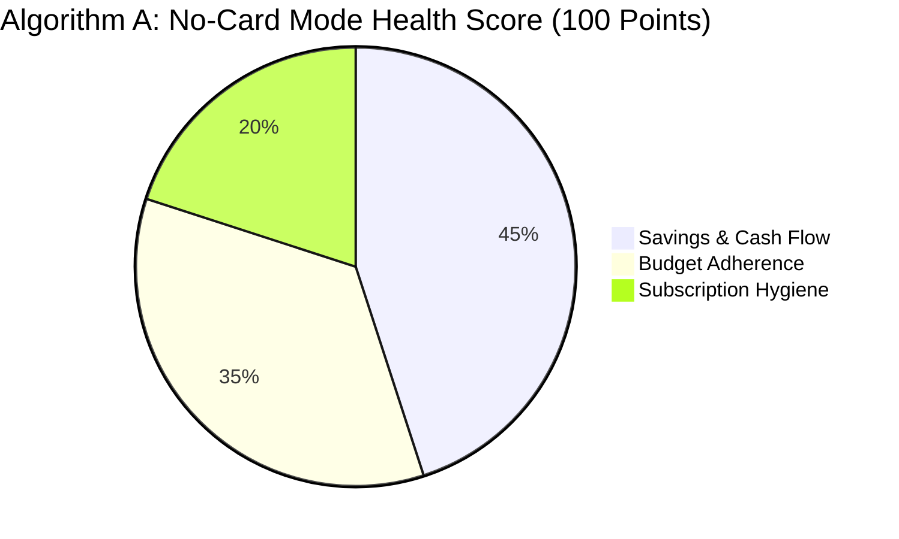
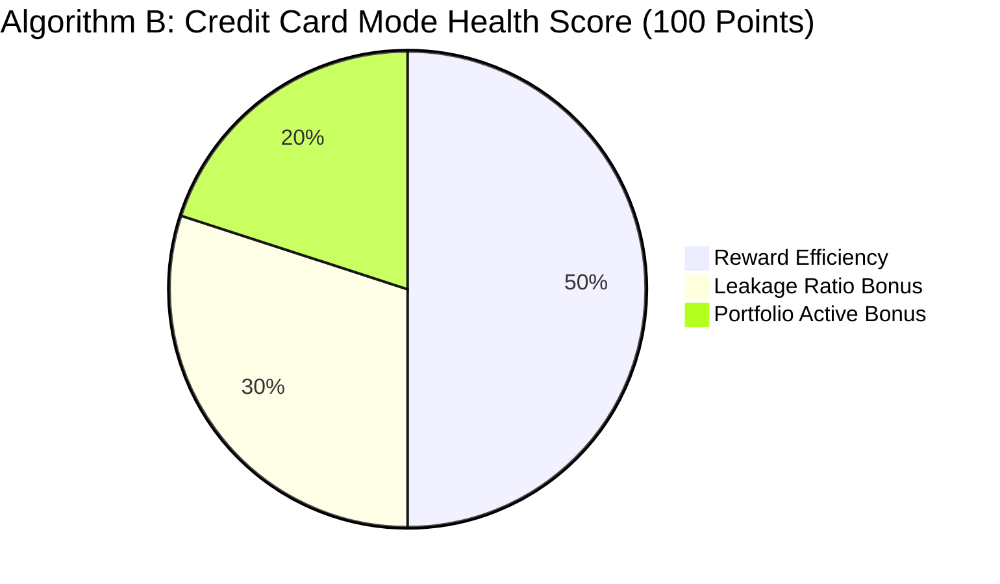

# CLIQ — AI, Machine Learning & Financial Calculation Logic

This document establishes the exact mathematical, algorithmic, and machine-learning foundations of CLIQ.

---

## 1. Algorithmic Classification Matrix

To ensure intellectual and engineering honesty, every intelligence component in CLIQ is explicitly classified:

| Engine / Component | Implementation Type | True Algorithmic Foundation |
| :--- | :--- | :--- |
| **`RewardOptimizationEngine`** | **Deterministic Logic** | Pure mathematical evaluation using Python `Decimal`. Zero ML. |
| **`FinancialHealthEngine`** | **Rule-Based Heuristic** | Multi-factor weighted index (0–100) using empirical financial benchmarks. Zero ML. |
| **`MerchantNormalizer`** | **Rule-Based Heuristic** | Exact regex dictionary mapping and string similarity scoring. Zero trained weights. |
| **`PredictionEngine`** | **Rule-Based Heuristic** | Moving average time-series thresholds and frequency variance checks. |
| **`CSV Deduplication Engine`** | **Deterministic Cryptography** | Canonical string normalization followed by SHA-256 hashing. |
| **`PrivacyGateway`** | **Deterministic Rules** | Pre-compiled regex patterns for Indian PII redaction and task allowlisting. |
| **`Financial Inclusion Calculators`** | **Deterministic Logic** | Closed-form financial formulas executed with `Decimal` precision. |
| **`MultilingualAssistantService`** | **LLM (External API)** | Google Gemini 2.5 Flash via direct HTTPX REST call to `generativelanguage.googleapis.com` (no Google SDK installed). Includes prompt engineering, local PII scrubbing, and deterministic fallback templates. |

> [!IMPORTANT]
> **Strict Engineering Rule:** Never describe regex matching or heuristic dictionaries as "machine learning" or "AI models". CLIQ deliberately uses deterministic code for financial math because generative models hallucinate numbers.

---

## 2. Deterministic Financial Math & Reward Calculation

All monetary arithmetic in CLIQ uses Python's `Decimal` type to prevent binary floating-point errors (e.g. `0.1 + 0.2 != 0.3`).

### 2.1 Reward Yield Evaluation
For a transaction with amount $A$, spending category $C$, and merchant $M$:

1. **Rule Selection:**
   - Check for specific merchant override rules on the card matching $M$.
   - If not found, match category-specific rule for $C$.
   - If not found, fall back to card base reward rate $R_{\text{base}}$.

2. **Gross Reward Calculation:**
   $$\text{Gross Points} = A \times \frac{R_{\text{rate}}}{100}$$

3. **Transaction & Monthly Cap Clipping:**
   $$\text{Capped Points} = \min(\text{Gross Points}, \text{Cap}_{\text{per\_txn}})$$
   $$\text{Net Points} = \min(\text{Capped Points}, \text{Cap}_{\text{monthly\_remaining}})$$

4. **Monetary Conversion:**
   $$\text{Monetary Reward (₹)} = \text{Net Points} \times V_{\text{point\_inr}}$$

---

## 3. Financial Health Radar Scoring Algorithm

The `FinancialHealthEngine` (`backend/app/services/financial_health/health_engine.py`) implements **two completely separate scoring algorithms** selected by pathway. The algorithm selection uses a logical OR:

```python
is_no_card_mode = (len(cards) == 0) or (financial_pathway == "NO_CREDIT_CARD")
```

This means a CREDIT_CARD pathway user who has not yet added any cards also receives Algorithm A (graceful fallback for new users with empty wallets).

---

### 3.1 Algorithm A — No-Card Mode (45 + 35 + 20 = 100 points)

Applied when: `financial_pathway == "NO_CREDIT_CARD"` **OR** user has zero cards registered.



**Pillar A: Savings & Cash Flow ($S_A \in [0, 45]$)**

Measures how much of monthly income is retained as savings.

$$\text{Savings Rate} = \frac{\text{Monthly Income} - \text{Monthly Expenses}}{\text{Monthly Income}}$$

| Savings Rate | Score |
| :--- | :--- |
| ≥ 30% | 45 |
| 20–29% | 35 |
| 10–19% | 22 |
| 1–9% | 12 |
| Deficit (< 0%) | 0 |

**Pillar B: Budget Adherence ($S_B \in [0, 35]$)**

Measures how closely actual spending matches planned budget categories. Score is proportional to the fraction of budget categories within their planned limits.

**Pillar C: Subscription Hygiene ($S_C \in [0, 20]$)**

$$\text{Sub Ratio} = \frac{\text{Monthly Recurring Subscriptions}}{\text{Monthly Income}}$$

| Sub Ratio | Score |
| :--- | :--- |
| ≤ 5% | 20 |
| 5–10% | 14 |
| 10–15% | 7 |
| > 15% | 0 |

---

### 3.2 Algorithm B — Credit Card Mode (50 + 30 + 20 = 100 points, floor 25)

Applied when: `financial_pathway == "CREDIT_CARD"` AND user has at least one card registered.



**Component 1: Reward Efficiency Rate ($C_1 \in [0, 50]$)**

$$\text{Efficiency Rate} = \frac{\text{Actual Rewards Earned}}{\text{Theoretical Maximum Rewards (all optimal card)}}$$

Score scales proportionally from 0–50 based on efficiency rate.

**Component 2: Leakage Ratio Bonus ($C_2 \in [0, 30]$)**

$$\text{Leakage Ratio} = \frac{\text{Transactions Using Optimal Card}}{\text{Total Card Transactions}}$$

Score scales proportionally from 0–30.

**Component 3: Portfolio Active Bonus ($C_3 = 20$ fixed)**

Fixed 20 points awarded for active multi-card portfolio engagement.

**Floor:** Score is floored at 25 to prevent near-zero scores when insufficient transaction history exists. Capped at 100.

---

### 3.3 DEF-05 Zero-Data Baseline
If the user profile is empty (zero transactions and zero incomes):
- The engine does NOT emit a synthetic score.
- It returns an honest score of `0`, status `INSUFFICIENT_DATA`, and guides the user to log their first transaction or income.

---

## 4. Cash Flow & Irregular Income Algorithms

### 4.1 Rolling 90-Day Monthly Median (DEF-03)
Freelancers and gig workers experience sharp volatility. Rather than an arithmetic mean (skewed by irregular windfalls), CLIQ buckets all received incomes in the last 90 days into three discrete calendar month totals:
$$\text{Month}_1 = \sum \text{Income}_{D \in [T-30, T]}$$
$$\text{Month}_2 = \sum \text{Income}_{D \in [T-60, T-31]}$$
$$\text{Month}_3 = \sum \text{Income}_{D \in [T-90, T-61]}$$
$$\text{Rolling Monthly Baseline} = \text{Median}(\text{Month}_1, \text{Month}_2, \text{Month}_3)$$

### 4.2 One-Time Income Expiration (DEF-04)
- When `frequency == 'ONE_TIME'`, the income is amortized over the 90-day window ($A_{\text{monthly}} = \text{Amount} / 3$).
- Once `received_date < now() - 90 days`, the one-time income completely expires from active monthly cash flow projections.

---

## 5. Financial Inclusion Closed-Form Calculators

Implemented in `backend/app/services/education/calculators.py`:

### 5.1 Card Fee Break-Even Calculator
$$\text{Spend Required} = \frac{\text{Annual Fee}}{\text{Effective Reward Rate (e.g. 0.02)}}$$

### 5.2 50/30/20 Budget Allocator
- **Needs (50%):** $\text{Income} \times 0.50$
- **Wants (30%):** $\text{Income} \times 0.30$
- **Savings (20%):** $\text{Income} \times 0.20$

### 5.3 Compounding Debt Calculator
For a debt balance $B_0$, monthly interest rate $r = \frac{\text{APR}}{12}$, monthly payment $P$, and month $k$:
$$B_k = B_{k-1} \times (1 + r) - P$$
$$\text{Total Interest Paid} = \sum_{k=1}^{n} (B_{k-1} \times r)$$

### 5.4 Minimum Payment Trap Calculator
Standard credit card minimum payment is the greater of 5% of outstanding balance or ₹500:
$$P_{\text{min}} = \max(B \times 0.05, 500)$$
If $B \times r \ge P_{\text{min}}$, the debt is mathematically perpetual (interest exceeds minimum payment). CLIQ flags this with an active warning and highlights the compounding payoff time in years.

