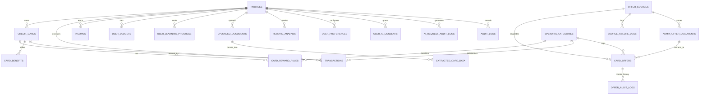

# CLIQ — Database Design & Data Model Reference

This document provides a comprehensive reference for CLIQ's relational database schema, entities, relationships, constraints, indexes, and migration history.

---

## 1. Schema Entity Relationship Diagram

---

## 2. Complete 21-Table Model Specification

### 2.1 User & Authentication Entities

#### `profiles` (12 columns)
- **Primary Key:** `id` (VARCHAR(36), UUID)
- **Fields:**
  - `email` (VARCHAR(255), UNIQUE, NOT NULL, indexed)
  - `hashed_password` (VARCHAR(255), NOT NULL)
  - `full_name` (VARCHAR(255), NOT NULL)
  - `preferred_language` (VARCHAR(10), DEFAULT 'en')
  - `currency` (VARCHAR(10), DEFAULT 'INR')
  - `role` (VARCHAR(32), DEFAULT 'USER')
  - `is_admin` (BOOLEAN, DEFAULT FALSE)
  - `financial_pathway` (VARCHAR(32), DEFAULT 'CREDIT_CARD', values: `'CREDIT_CARD'`, `'NO_CREDIT_CARD'`)
  - `is_active` (BOOLEAN, DEFAULT TRUE)
  - `created_at` (DATETIME, DEFAULT utcnow)
  - `updated_at` (DATETIME, DEFAULT utcnow, onupdate utcnow)

#### `user_preferences` (10 columns)
- **Primary Key:** `id` (VARCHAR(36), UUID)
- **Foreign Key:** `user_id` -> `profiles.id` (ON DELETE CASCADE, UNIQUE)
- **Fields:**
  - `prioritize_cashback` (BOOLEAN, DEFAULT TRUE)
  - `prioritize_miles` (BOOLEAN, DEFAULT FALSE)
  - `include_annual_fee_in_net` (BOOLEAN, DEFAULT TRUE)
  - `monthly_spend_target` (NUMERIC(12, 2), NULLABLE)
  - `financial_path` (VARCHAR(64), NULLABLE)
  - `budget_alert_threshold` (NUMERIC(5, 2), DEFAULT 80.00)
  - `created_at`, `updated_at` (DATETIME)

#### `audit_logs` (8 columns)
- **Primary Key:** `id` (VARCHAR(36), UUID)
- **Foreign Key:** `user_id` -> `profiles.id` (ON DELETE SET NULL, indexed)
- **Fields:**
  - `action` (VARCHAR(128), NOT NULL)
  - `ip_address` (VARCHAR(64), NULLABLE)
  - `user_agent` (VARCHAR(255), NULLABLE)
  - `status` (VARCHAR(32), DEFAULT 'SUCCESS')
  - `details_json` (TEXT, NULLABLE)
  - `timestamp` (DATETIME, DEFAULT utcnow, indexed)

---

### 2.2 Credit Card Portfolio Entities

#### `credit_cards` (20 columns)
- **Primary Key:** `id` (VARCHAR(36), UUID)
- **Foreign Key:** `user_id` -> `profiles.id` (ON DELETE CASCADE, indexed)
- **Fields:**
  - `card_name` (VARCHAR(128), NOT NULL)
  - `bank_name` (VARCHAR(128), NOT NULL)
  - `network` (VARCHAR(32), NOT NULL, e.g., 'Visa', 'Mastercard', 'RuPay', 'Amex')
  - `card_type` (VARCHAR(32), DEFAULT 'CREDIT')
  - `card_variant` (VARCHAR(64), NULLABLE)
  - `cardholder_name` (VARCHAR(128), NOT NULL)
  - `nickname` (VARCHAR(128), NULLABLE)
  - `last_four_digits` (VARCHAR(4), NOT NULL)
  - `joining_fee` (NUMERIC(10, 2), DEFAULT 0.00)
  - `annual_fee` (NUMERIC(10, 2), DEFAULT 0.00)
  - `renewal_waiver_spend` (NUMERIC(12, 2), NULLABLE)
  - `fee_waiver_condition_details` (VARCHAR(255), NULLABLE)
  - `renewal_date` (DATETIME, NULLABLE)
  - `billing_cycle_day` (INTEGER, NULLABLE)
  - `terms_source_url` (VARCHAR(512), NULLABLE)
  - `is_active` (BOOLEAN, DEFAULT TRUE)
  - `created_at`, `updated_at` (DATETIME)

#### `card_reward_rules` (14 columns)
- **Primary Key:** `id` (VARCHAR(36), UUID)
- **Foreign Key:** `card_id` -> `credit_cards.id` (ON DELETE CASCADE, indexed)
- **Fields:**
  - `category_id` (VARCHAR(64), NULLABLE, indexed)
  - `merchant_pattern` (VARCHAR(128), NULLABLE)
  - `reward_type` (VARCHAR(32), NOT NULL, values: `'CASHBACK'`, `'POINTS'`, `'MILES'`)
  - `reward_rate_percentage` (NUMERIC(5, 2), NOT NULL)
  - `point_monetary_value` (NUMERIC(6, 4), DEFAULT 1.0000)
  - `min_transaction_amount` (NUMERIC(10, 2), DEFAULT 0.00)
  - `max_reward_per_transaction` (NUMERIC(10, 2), NULLABLE)
  - `monthly_cap_amount` (NUMERIC(10, 2), NULLABLE)
  - `is_excluded` (BOOLEAN, DEFAULT FALSE)
  - `exclusion_reason` (VARCHAR(255), NULLABLE)
  - `created_at`, `updated_at` (DATETIME)

#### `card_benefits` (20 columns)
- **Primary Key:** `id` (VARCHAR(36), UUID)
- **Foreign Key:** `card_id` -> `credit_cards.id` (ON DELETE CASCADE, indexed)
- **Fields:**
  - `benefit_type` (VARCHAR(64), NOT NULL)
  - `title` (VARCHAR(255), NOT NULL)
  - `description` (TEXT, NULLABLE)
  - `applicable_category` (VARCHAR(64), NULLABLE)
  - `reward_percentage_or_points` (NUMERIC(6, 2), NULLABLE)
  - `reward_basis` (VARCHAR(32), NULLABLE)
  - `max_reward` (NUMERIC(10, 2), NULLABLE)
  - `min_transaction_amount` (NUMERIC(10, 2), NULLABLE)
  - `cap_amount` (NUMERIC(10, 2), NULLABLE)
  - `cap_period` (VARCHAR(32), NULLABLE)
  - `eligibility_restrictions` (VARCHAR(255), NULLABLE)
  - `valid_from`, `valid_to` (DATETIME, NULLABLE)
  - `terms_and_conditions` (TEXT, NULLABLE)
  - `source_reference` (VARCHAR(512), NULLABLE)
  - `last_verified_date` (DATETIME, NULLABLE)
  - `annual_value_estimate` (NUMERIC(10, 2), NULLABLE)
  - `created_at` (DATETIME)

---

### 2.3 Financial Operations & Incomes

#### `transactions` (20 columns)
- **Primary Key:** `id` (VARCHAR(36), UUID)
- **Foreign Keys:**
  - `user_id` -> `profiles.id` (ON DELETE CASCADE, indexed)
  - `card_id` -> `credit_cards.id` (ON DELETE SET NULL, NULLABLE, indexed)
  - `category_id` -> `spending_categories.id` (ON DELETE SET NULL, NULLABLE, indexed)
  - `optimal_card_id` -> `credit_cards.id` (ON DELETE SET NULL, NULLABLE)
- **Fields:**
  - `merchant_name` (VARCHAR(255), NOT NULL)
  - `amount` (NUMERIC(12, 2), NOT NULL)
  - `currency` (VARCHAR(10), DEFAULT 'INR')
  - `transaction_date` (DATETIME, NOT NULL, indexed)
  - `is_recurring` (BOOLEAN, DEFAULT FALSE)
  - `reward_earned_monetary` (NUMERIC(10, 2), DEFAULT 0.00)
  - `potential_optimal_reward` (NUMERIC(10, 2), DEFAULT 0.00)
  - `notes` (TEXT, NULLABLE)
  - `raw_description` (VARCHAR(500), NULLABLE)
  - `reference_number` (VARCHAR(128), NULLABLE)
  - `deduplication_hash` (VARCHAR(64), NULLABLE, indexed)
  - `import_batch_id` (VARCHAR(36), NULLABLE)
  - `category_confidence` (NUMERIC(4, 2), DEFAULT 1.00)
  - `payment_method` (VARCHAR(32), DEFAULT 'CREDIT_CARD', values: `'CREDIT_CARD'`, `'DEBIT_CARD'`, `'UPI'`, `'CASH'`, `'BANK_TRANSFER'`, `'OTHER'`)
  - `created_at` (DATETIME)

#### `incomes` (12 columns)
- **Primary Key:** `id` (VARCHAR(36), UUID)
- **Foreign Key:** `user_id` -> `profiles.id` (ON DELETE CASCADE, indexed)
- **Fields:**
  - `source_name` (VARCHAR(128), NOT NULL)
  - `amount` (NUMERIC(12, 2), NOT NULL)
  - `currency` (VARCHAR(10), DEFAULT 'INR')
  - `frequency` (VARCHAR(32), DEFAULT 'MONTHLY', values: `'MONTHLY'`, `'BIWEEKLY'`, `'WEEKLY'`, `'ONE_TIME'`)
  - `is_irregular` (BOOLEAN, DEFAULT FALSE)
  - `received_date` (DATETIME, NOT NULL, indexed: `ix_incomes_received_date`)
  - `expected_date` (DATETIME, NULLABLE)
  - `notes` (TEXT, NULLABLE)
  - `created_at`, `updated_at` (DATETIME)

#### `user_budgets` (7 columns)
- **Primary Key:** `id` (VARCHAR(36), UUID)
- **Foreign Key:** `user_id` -> `profiles.id` (ON DELETE CASCADE, UNIQUE)
- **Fields:**
  - `monthly_income` (NUMERIC(12, 2), DEFAULT 0.00)
  - `total_budget` (NUMERIC(12, 2), DEFAULT 0.00)
  - `category_budgets_json` (TEXT, NULLABLE)
  - `created_at`, `updated_at` (DATETIME)

#### `spending_categories` (6 columns)
- **Primary Key:** `id` (VARCHAR(64), e.g., 'dining', 'travel', 'grocery')
- **Fields:**
  - `display_name_en` (VARCHAR(128), NOT NULL)
  - `display_name_hi` (VARCHAR(128), NOT NULL)
  - `display_name_kn` (VARCHAR(128), NOT NULL)
  - `icon_name` (VARCHAR(64), NOT NULL)
  - `description` (VARCHAR(255), NULLABLE)

---

### 2.4 Educational Entities

#### `user_learning_progress` (10 columns)
- **Primary Key:** `id` (VARCHAR(36), UUID)
- **Foreign Key:** `user_id` -> `profiles.id` (ON DELETE CASCADE, indexed)
- **Unique Constraint:** `(user_id, topic_id)`
- **Fields:**
  - `topic_id` (VARCHAR(64), NOT NULL)
  - `category_id` (VARCHAR(64), NOT NULL)
  - `is_completed` (BOOLEAN, DEFAULT FALSE)
  - `quiz_score` (INTEGER, NULLABLE)
  - `notes` (TEXT, NULLABLE)
  - `completed_at` (DATETIME, NULLABLE)
  - `created_at`, `updated_at` (DATETIME)

---

### 2.5 Bank Offers & Ingestion Infrastructure

#### `offer_sources` (20 columns)
- **Primary Key:** `id` (VARCHAR(36), UUID)
- **Unique Constraint:** `source_key` (VARCHAR(64), UNIQUE)
- **Fields:**
  - `source_name`, `domain`, `source_type` (VARCHAR)
  - `supported_ingestion_methods_json` (TEXT)
  - `access_permission_status`, `connector_status`, `source_health` (VARCHAR)
  - `last_successful_fetch`, `last_attempted_fetch` (DATETIME)
  - `last_http_status`, `consecutive_failures`, `rate_limit_per_minute` (INTEGER)
  - `active_offers_count` (INTEGER, DEFAULT 0)
  - `notes` (TEXT), `created_at`, `updated_at` (DATETIME)

#### `admin_offer_documents` (15 columns)
- **Primary Key:** `id` (VARCHAR(36), UUID)
- **Foreign Key:** `source_id` -> `offer_sources.id` (ON DELETE SET NULL)
- **Fields:**
  - `filename`, `file_path`, `mime_type` (VARCHAR)
  - `file_size_bytes` (INTEGER)
  - `sha256_hash` (VARCHAR(64), NOT NULL, indexed)
  - `uploaded_by_id`, `uploaded_by_name` (VARCHAR)
  - `processing_status` (VARCHAR(32), DEFAULT 'PENDING')
  - `extracted_offers_count` (INTEGER, DEFAULT 0)
  - `ocr_supported` (BOOLEAN, DEFAULT FALSE)
  - `raw_text_sample` (TEXT), `uploaded_at` (DATETIME)

#### `source_failure_logs` (9 columns)
- **Primary Key:** `id` (VARCHAR(36), UUID)
- **Foreign Key:** `source_id` -> `offer_sources.id` (ON DELETE CASCADE)
- **Fields:**
  - `http_status` (INTEGER), `error_type` (VARCHAR(64)), `error_message` (TEXT)
  - `attempt_number`, `retry_after_seconds` (INTEGER)
  - `context_json` (TEXT), `timestamp` (DATETIME)

#### `card_offers` (37 columns)
- **Primary Key:** `id` (VARCHAR(36), UUID)
- **Foreign Keys:**
  - `source_id` -> `offer_sources.id` (ON DELETE SET NULL)
  - `source_document_id` -> `admin_offer_documents.id` (ON DELETE SET NULL)
- **Fields:**
  - `ingestion_channel` (VARCHAR(32), e.g., 'PDF_CIRCULAR', 'HTML_SCRAPE', 'PARTNER_API', 'MANUAL')
  - `merchant_name` (VARCHAR(128)), `offer_title` (VARCHAR(255)), `category_id` (VARCHAR(64))
  - `discount_type` (VARCHAR(32)), `discount_value` (NUMERIC(10, 2))
  - `min_transaction_value`, `max_discount_amount` (NUMERIC(10, 2))
  - `eligible_bank`, `eligible_network`, `eligible_card_names_json`
  - `valid_from`, `valid_to` (DATETIME)
  - `payment_channel`, `promo_code`, `activation_requirement`, `terms_and_conditions`, `source_url`
  - `source_evidence` (TEXT), `extraction_confidence` (NUMERIC(4, 2))
  - `verification_status` (VARCHAR(32), values: `'PENDING_REVIEW'`, `'VERIFIED'`, `'REJECTED'`, `'NEEDS_REVERIFICATION'`)
  - `freshness_state` (VARCHAR(32), values: `'LIVE'`, `'STALE'`, `'EXPIRED'`)
  - `content_hash` (VARCHAR(64), indexed), `version` (INTEGER, DEFAULT 1)
  - `reviewed_by_id`, `reviewed_by_name`, `reviewed_at`, `last_verified_timestamp`
  - `created_at`, `updated_at` (DATETIME)

#### `offer_audit_logs` (11 columns)
- **Primary Key:** `id` (VARCHAR(36), UUID)
- **Foreign Key:** `offer_id` -> `card_offers.id` (ON DELETE CASCADE)
- **Fields:**
  - `action`, `actor_id`, `actor_name`, `actor_role`
  - `from_status`, `to_status`, `notes`, `snapshot_json`, `timestamp`

---

### 2.6 Privacy, Consent & AI Auditing

#### `user_ai_consents` (10 columns)
- **Primary Key:** `id` (VARCHAR(36), UUID)
- **Foreign Key:** `user_id` -> `profiles.id` (ON DELETE CASCADE, UNIQUE)
- **Fields:**
  - `external_ai_enabled` (BOOLEAN, DEFAULT FALSE)
  - `allow_card_context` (BOOLEAN, DEFAULT FALSE)
  - `allow_spending_context` (BOOLEAN, DEFAULT FALSE)
  - `provider_preference` (VARCHAR(32), DEFAULT 'GEMINI')
  - `consent_version` (VARCHAR(16), DEFAULT '1.0')
  - `consent_timestamp` (DATETIME), `revoked_at` (DATETIME)
  - `purpose_description` (VARCHAR(255))

#### `ai_request_audit_logs` (16 columns)
- **Primary Key:** `id` (VARCHAR(36), UUID)
- **Foreign Key:** `user_id` -> `profiles.id` (ON DELETE SET NULL)
- **Fields:**
  - `request_id` (VARCHAR(64), UNIQUE)
  - `task_type` (VARCHAR(64)), `data_classification` (VARCHAR(32))
  - `provider` (VARCHAR(32)), `model_name` (VARCHAR(64))
  - `consent_status` (VARCHAR(32)), `redaction_count` (INTEGER)
  - `redacted_types_json` (VARCHAR(255))
  - `prompt_tokens`, `completion_tokens`, `latency_ms` (INTEGER)
  - `status` (VARCHAR(32)), `rejection_reason` (VARCHAR(255))
  - `timestamp` (DATETIME, DEFAULT utcnow)

---

### 2.7 Documents & Analytics

#### `uploaded_documents` (9 columns) & `extracted_card_data` (13 columns)
- Store user-uploaded statement files, processing statuses, OCR confidence scores, and extracted card parameters.

#### `reward_analysis` (12 columns)
- Audit log of optimization queries: transaction amounts, requested merchants, recommended card IDs, expected monetary yields, and alternative rankings.

---

## 3. Alembic Migration History

All database evolutions are captured in versioned migration scripts inside `backend/alembic/versions/`:

1. **`1bcc80487546_initial_schema.py`:**
   - Establishes foundational schema: `profiles`, `credit_cards`, `card_reward_rules`, `card_benefits`, `spending_categories`, `transactions`, `uploaded_documents`, `extracted_card_data`, `reward_analysis`, `user_preferences`, `audit_logs`, `user_ai_consents`, `ai_request_audit_logs`, `offer_sources`, `admin_offer_documents`, `source_failure_logs`, `card_offers`, `offer_audit_logs`.
2. **`70d32b55c78e_add_financial_inclusion_models.py`:**
   - Adds `user_budgets` and `user_learning_progress` tables for CLIQ Learn and budgeting.
3. **`c1f3a2b4e5d6_add_no_card_mode_incomes_and_pathway.py`:**
   - Adds `financial_pathway` column to `profiles`.
   - Creates the `incomes` table with index on `received_date`.
   - Adds `payment_method` column to `transactions`.

