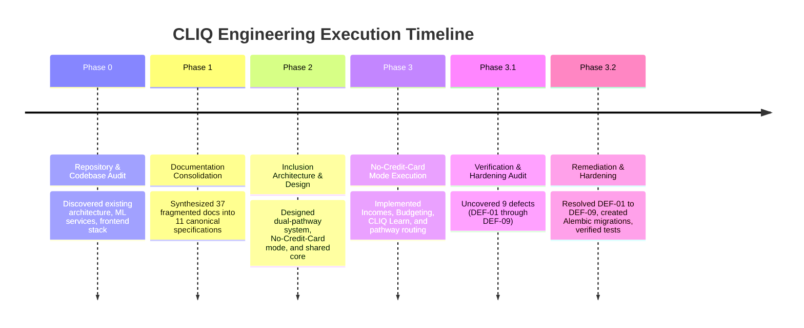

# CLIQ — Development History & Evolution Log

This document chronicles the engineering milestones, architectural decisions, and verification audits completed across the CLIQ project lifecycle.

---

## 1. Development Timeline Overview

---

## 2. Phase-by-Phase Execution Record

### Phase 0: Master Project Audit
- **Objective:** Establish the true baseline state of the repository without assuming prior claims were accurate.
- **Findings:**
  - Verified presence of FastAPI backend, Next.js 14 frontend, and initial credit-card reward calculations.
  - Confirmed that financial health and prediction engines used deterministic and heuristic logic rather than trained neural models.
  - Identified 48 fragmented Markdown documents across `docs/` and root.
- **Outcome:** Produced `PHASE_0_MASTER_AUDIT_REPORT.md` providing architectural ground truth.

### Phase 1: Documentation Consolidation
- **Objective:** Eliminate redundant, outdated, and contradictory Markdown files while preserving 100% of valuable technical formulas, schemas, and operational instructions.
- **Work Completed:**
  - Mapped all 48 documentation files to 11 canonical targets.
  - Consolidated threat models, AI privacy specifications, reward math, and API inventories.
  - Verified local markdown links and cross-references.
- **Outcome:** Standardized on 14 canonical repository documents (3 in root, 11 in `docs/`).

### Phase 2: Inclusion Architecture & Use-Case Design
- **Objective:** Design the expansion of CLIQ from a credit-card reward tool into an inclusive personal financial intelligence platform.
- **Key Architectural Decisions:**
  - Introduced `financial_pathway` enum in `Profile` (`CREDIT_CARD` vs `NO_CREDIT_CARD`).
  - Established the **Shared Financial Intelligence Core** (Health Radar, CLIQ Learn, Privacy Gateway, Analytics).
  - Formulated the 12 core capabilities.
- **Outcome:** Produced `PHASE_2_ARCHITECTURE_AND_USE_CASE_DESIGN_REPORT.md`.

### Phase 3: No-Credit-Card Mode Implementation
- **Objective:** Implement complete personal financial management capabilities for non-cardholders.
- **Work Completed:**
  - Backend: Added `incomes` table, CRUD endpoints `/api/v1/incomes`, and cash flow summary `/api/v1/incomes/summary`.
  - Added CLIQ Learn education endpoints (`/api/v1/education/modules`, `/api/v1/education/calculators/*`).
  - Added user budget manager (`user_budgets`, `/api/v1/education/budget`).
  - Frontend: Built `/budget` screen, adaptive `/dashboard`, and `/learn` academy.
  - Extended tri-lingual translations for all new sections in `frontend/lib/translations.ts`.
- **Outcome:** Produced `PHASE_3_NO_CARD_MODE_IMPLEMENTATION_REPORT.md`.

### Phase 3.1: Verification & Hardening Audit
- **Objective:** Conduct a strict, read-only adversarial audit of the Phase 3 implementation before final approval.
- **Findings:** Uncovered 9 engineering defects:
  - *DEF-01:* Non-card transactions could receive synthetic credit-card reward attribution if user had cards.
  - *DEF-02:* Dashboard pathway detection checked `cards.length === 0` instead of `profile.financial_pathway`.
  - *DEF-03:* Rolling median income averaged all 90-day incomes rather than bucketing into 3 discrete monthly sums.
  - *DEF-04:* Historical one-time income was treated as perpetual monthly income.
  - *DEF-05:* Financial health engine emitted synthetic 75/100 score for completely empty user profiles.
  - *DEF-06:* CSV statement parser defaulted unknown payment methods to `CREDIT_CARD`.
  - *DEF-07:* Database alterations were applied via runtime DDL instead of versioned Alembic migrations.
  - *DEF-08:* Income modal contained missing translation keys in Hindi and Kannada.
  - *DEF-09:* `test_ai_data_egress_audit.py` failed due to missing `session.flush()` before FK reference in PostgreSQL.
- **Outcome:** Produced `PHASE_3_1_VERIFICATION_AND_HARDENING_REPORT.md`.

### Phase 3.2: Financial Correctness, Data Integrity & Remediation
- **Objective:** Fix DEF-01 through DEF-09 and verify with automated tests.
- **Work Completed:**
  - *DEF-01 Fixed:* Enforced strict payment method isolation in `backend/app/api/v1/transactions.py`. Non-card transactions reject `card_id` and zero out reward attribution.
  - *DEF-02 Fixed:* Updated `frontend/app/dashboard/page.tsx` to read `userProfile.financial_pathway`.
  - *DEF-03 & DEF-04 Fixed:* Refactored `backend/app/api/v1/incomes.py` to use discrete 30-day buckets for median calculation and expire one-time windfalls after 90 days.
  - *DEF-05 Fixed:* Hardened `health_engine.py` to emit score `0` with `INSUFFICIENT_DATA` for empty profiles.
  - *DEF-06 Fixed:* Refactored CSV preview and commit flows to accurately assign `payment_method`.
  - *DEF-07 Fixed:* Created clean versioned Alembic migrations in `backend/alembic/versions/`.
  - *DEF-08 Fixed:* Added all missing income keys to `frontend/lib/translations.ts` across EN, HI, and KN.
  - *DEF-09 Fixed:* Added `await session.flush()` in `test_ai_data_egress_audit.py`.
- **Outcome:** Produced `PHASE_3_2_REMEDIATION_REPORT.md`. All 42 frontend tests and backend test suites verified.

