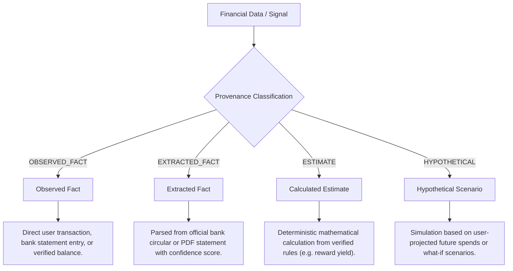

# CLIQ — Explainability, Decision Provenance & Fact Classification

This document details the transparent decision-making architecture of CLIQ. CLIQ strictly enforces a **Zero Black-Box** standard across all recommendations, reward projections, and financial health evaluations.

---

## 1. Information Provenance Taxonomy

Every piece of financial data displayed in CLIQ is assigned a rigorous provenance classification:



### Classification Standards:
1. **`OBSERVED_FACT`:** Immutable records verified by primary sources (e.g., a posted transaction of ₹1,450 at Swiggy on Oct 14).
2. **`EXTRACTED_FACT`:** Data extracted from bank documents or web connectors, carrying an `extraction_confidence` score (e.g., "10% Instant Discount on SBI Cards" extracted with 0.91 confidence).
3. **`ESTIMATE`:** Deterministically computed metrics based on verified historical facts (e.g., Projected annual fee break-even spend).
4. **`HYPOTHETICAL`:** User-configured simulations (e.g., "If I spend ₹20,000 monthly on Dining, which card gives the highest yield?").

---

## 2. Recommendation Explainability & Audit Breakdown

Whenever CLIQ's `RewardOptimizationEngine` recommends a credit card for a purchase, the API response includes a detailed mathematical proof stored in `calculation_breakdown_json`.

### 2.1 Audit Breakdown Structure
```json
{
  "recommended_card_id": "card-hdfc-millennia",
  "recommended_card_name": "HDFC Millennia Credit Card",
  "transaction_amount": 2500.00,
  "category_id": "dining",
  "merchant_name": "Swiggy",
  "calculation_breakdown": {
    "base_rate_percentage": 1.0,
    "category_multiplier": 5.0,
    "effective_reward_rate": 5.0,
    "gross_points": 125.0,
    "point_monetary_value": 1.0,
    "transaction_cap_applied": false,
    "monthly_cap_amount": 1000.0,
    "monthly_spend_to_date": 350.0,
    "net_monetary_reward": 125.00,
    "rule_applied_id": "rule-swiggy-5pct",
    "rationale": "Applied 5% cashback on Swiggy online dining partner rule."
  },
  "alternatives": [
    {
      "card_id": "card-sbi-simplyclick",
      "card_name": "SBI SimplyCLICK",
      "expected_reward": 50.00,
      "effective_rate": 2.0,
      "delta_vs_best": -75.00,
      "why_not_chosen": "Lower category reward rate (2.0% vs 5.0%)."
    },
    {
      "card_id": "card-icici-platinum",
      "card_name": "ICICI Platinum Chip",
      "expected_reward": 12.50,
      "effective_rate": 0.5,
      "delta_vs_best": -112.50,
      "why_not_chosen": "Base general spend tier (0.5%) without dining partner boost."
    }
  ]
}
```

### 2.2 Explainability Invariants
1. **Full Transparency:** The user can see exactly why Card A won over Card B and Card C.
2. **Deterministic Reproducibility:** Anyone evaluating the formula with the same inputs will produce the exact same reward figure down to the paisa.
3. **No Hidden Sponsorship:** Recommendations are ranked strictly by mathematical monetary yield, never by affiliate agreements.

---

## 3. Discovered Offer Provenance & Verification Traces

Bank offers in CLIQ carry transparent provenance metadata ensuring users can verify terms themselves:

- **Source Reference:** Exact URL or document where the offer was discovered (`source_url`).
- **Verbatim Evidence:** Unaltered excerpt from the official banner or terms (`source_evidence`).
- **Extraction Confidence:** Score from 0.00 to 1.00 (`extraction_confidence`).
- **Reviewer Attestation:** Identity and timestamp of the administrator who verified the offer (`reviewed_by_name`, `reviewed_at`).
- **Content Fingerprint:** SHA-256 hash of canonical offer terms (`content_hash`) to track material changes.

---

## 4. Financial Health Radar Deconstruction

Rather than presenting an arbitrary number, the 0–100 financial health radar deconstructs into clear components:

1. **Savings Rate Gauge (0–30 pts):**
   - *Explanation:* "You saved 22% of your monthly income this month, earning 25 out of 30 points. Boosting savings to 30% would add 5 points."
2. **Expense Ratio Gauge (0–25 pts):**
   - *Explanation:* "Essential expenses took up 58% of income, well within the safe 70% boundary."
3. **Subscription Health Gauge (0–20 pts):**
   - *Explanation:* "Recurring subscriptions account for 6% of income (₹3,000/month). Safe limit is under 10%."
4. **Credit Utilization Gauge (0–25 pts):**
   - *Explanation:* "Card balance is 18% of available limit. Kept safely below the 30% credit score risk line."
   - *No-Credit-Card Adaptation:* If in No-Credit-Card mode, this gauge is explicitly marked omitted and remaining points are normalized.

