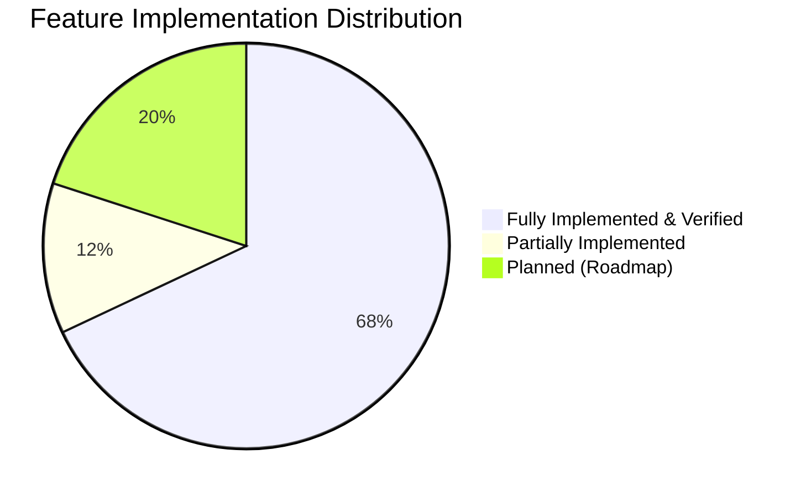

# CLIQ — Implementation Status & Feature Matrix

This document provides a rigorous, verified inventory of CLIQ's implementation status as of version **0.4.0** (post-Phase 3.2 remediation).

---

## 1. Overall Platform Implementation Status

---

## 2. Detailed Capability Status Matrix

| Capability / Module | Backend | Frontend | Database | Tests | Overall Status | Notes |
| :--- | :---: | :---: | :---: | :---: | :---: | :--- |
| **User Authentication & RBAC** | ✅ Done | ✅ Done | ✅ Done | ✅ Done | **Implemented** | JWT HS256, Bcrypt, Role ('USER', 'ADMIN'). |
| **Financial Pathways (CC vs No-CC)** | ✅ Done | ✅ Done | ✅ Done | ✅ Done | **Implemented** | `Profile.financial_pathway`, adaptive dashboard. |
| **Credit Card Wallet & Management** | ✅ Done | ✅ Done | ✅ Done | ✅ Done | **Implemented** | Multi-card CRUD, 4-digit tokenization, fees. |
| **Deterministic Reward Optimization** | ✅ Done | ✅ Done | ✅ Done | ✅ Done | **Implemented** | Pure Decimal math, rules, caps, comparisons. |
| **No-Credit-Card Mode Core** | ✅ Done | ✅ Done | ✅ Done | ✅ Done | **Implemented** | Incomes CRUD, cash flow, 90-day rolling median. |
| **DEF-01 Reward Attribution Quarantine** | ✅ Done | N/A | ✅ Done | ✅ Done | **Implemented** | Non-card txns strictly isolated from rewards. |
| **DEF-02 Dashboard Pathway Detection** | N/A | ✅ Done | N/A | ✅ Done | **Implemented** | Uses profile pathway, not card count. |
| **DEF-03 Rolling Median Calculation** | ✅ Done | N/A | N/A | ✅ Done | **Implemented** | Discrete 3-month bucketing median. |
| **DEF-04 Windfall Expiration** | ✅ Done | N/A | N/A | ✅ Done | **Implemented** | 90-day amortization and expiry. |
| **DEF-05 Zero-Score Baseline** | ✅ Done | ✅ Done | N/A | ✅ Done | **Implemented** | Emits honest 0 with `INSUFFICIENT_DATA`. |
| **DEF-06 CSV Payment Method Parsing** | ✅ Done | ✅ Done | N/A | ✅ Done | **Implemented** | Resolves actual payment method in CSVs. |
| **DEF-07 Alembic Migration Versioning** | ✅ Done | N/A | ✅ Done | ✅ Done | **Implemented** | 3 clean versioned migrations in `alembic/`. |
| **DEF-08 Incomes Localization** | N/A | ✅ Done | N/A | ✅ Done | **Implemented** | Full EN, HI, KN translations for incomes. |
| **DEF-09 Security Fixture DB Flush** | ✅ Done | N/A | N/A | ✅ Done | **Implemented** | Fixed parent Profile FK flush in tests. |
| **CLIQ Learn & Calculators** | ✅ Done | ✅ Done | ✅ Done | ✅ Done | **Implemented** | 6 modules, 5 calculators, progress tracking. |
| **Bank Offers Ingestion Desk** | ✅ Done | ✅ Done | ✅ Done | ✅ Done | **Implemented** | Multi-channel ingestion, admin review queue. |
| **Statement CSV Ingestion** | ✅ Done | ✅ Done | ✅ Done | ✅ Done | **Implemented** | HDFC, SBI, ICICI, Axis + SHA-256 deduplication. |
| **Privacy Gateway & PII Redaction** | ✅ Done | ✅ Done | ✅ Done | ✅ Done | **Implemented** | 6 Indian PII regex patterns, consent ledger. |
| **Multilingual Engine (EN, HI, KN)** | ✅ Done | ✅ Done | ✅ Done | ✅ Done | **Implemented** | In-memory dictionary, 20 screens covered. |
| **Financial Scam Shield** | ⏳ Planned | ⏳ Planned | ⏳ Planned | ⏳ Planned | **Planned** | Phase 4 Milestone. |
| **Financial Document Intelligence (OCR)**| 🔄 Partial | 🔄 Partial | ✅ Done | 🔄 Partial | **Partially Implemented** | PDF upload live; client-side OCR pending. |
| **Emergency Fund Runway Intelligence** | ⏳ Planned | ⏳ Planned | ⏳ Planned | ⏳ Planned | **Planned** | Phase 6 Milestone. |
| **Financial Resilience Profile** | ⏳ Planned | ⏳ Planned | ⏳ Planned | ⏳ Planned | **Planned** | Phase 6 Milestone. |
| **Voice Accessibility & Text Narrator** | ⏳ Planned | ⏳ Planned | N/A | ⏳ Planned | **Planned** | Phase 7 Milestone. |
| **Financial Benefits Navigator** | ⏳ Planned | ⏳ Planned | ⏳ Planned | ⏳ Planned | **Planned** | Phase 8 Milestone. |
| **Credit Readiness Pathway** | ⏳ Planned | ⏳ Planned | ⏳ Planned | ⏳ Planned | **Planned** | Phase 9 Milestone. |

---

## 3. Route & Screen Implementation Verification

- **Backend Endpoints:** Exactly 61 OpenAPI routes verified in `backend/app/main.py`.
- **Frontend Pages:** Exactly 20 Next.js pages compiling into 23 static routes (`npm run build` exits 0).
- **Backend Test Suites:** 20 test modules covering security, units, API, and integration.
- **Frontend Test Suites:** 7 test suites, 42 tests passing (`npm test` exits 0).
- **Alembic Migrations:** 3 migrations tracked and synced.

