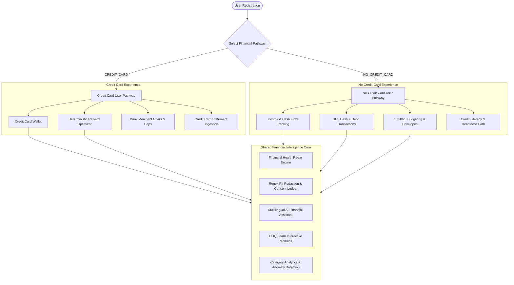

# CLIQ — Master Project Context & Product Vision

---

## 1. Product Identity

- **Product Name:** CLIQ
- **Classification:** AI-Powered Personal Financial Intelligence Platform
- **Vision:** *"Financial intelligence for everyone, not just people who already have access to credit."*
- **Tagline:** *"Money Made Simple. In Your Language."*
- **Operating Philosophy:**
  CLIQ began as a credit-card reward optimization platform and has evolved into a privacy-first, inclusive financial intelligence platform. Financial inclusion is not a marketing afterthought — it is a structural pillar. Financial intelligence, debt hazard prevention, budget management, and responsible cash flow planning must be accessible to every person, regardless of income, language, financial literacy, or whether they own a credit card.

---

## 2. Target User Cohorts

CLIQ is built to serve 6 distinct personas:

1. **Students & Young Adults:**
   - Often have zero credit history, small or volatile allowances/stipends, and high vulnerability to predatory Buy Now Pay Later (BNPL) schemes or hidden subscription traps.
   - *CLIQ Solution:* Guided budget envelopes (50/30/20), recurring payment detection, debt trap education, zero-fee financial tracking.

2. **No-Credit-Card Users & First-Time Earners:**
   - Rely predominantly on UPI (Unified Payments Interface), Debit Cards, Cash, and Net Banking. In traditional finance apps, they are bombarded with irrelevant credit card advertisements.
   - *CLIQ Solution:* Dedicated **No-Credit-Card Mode**, clean cash flow tracking, expense categorization, savings rate analytics without credit card prerequisites.

3. **Freelancers & Irregular-Income Earners:**
   - Income fluctuates unpredictably month-to-month, rendering static monthly budgeting models obsolete.
   - *CLIQ Solution:* Non-linear cash flow tracking, 90-day rolling monthly median income normalization, one-time windfall expiration rules.

4. **People With Limited Financial Literacy:**
   - Complex financial jargon (e.g., APR, rolling interest, minimum amount due, compounding interest) obscures the reality of debt traps.
   - *CLIQ Solution:* CLIQ Learn Academy, plain-language debt calculators, minimum payment trap warnings, transparent financial health scoring.

5. **Existing Credit Card Users & Optimizers:**
   - Own multiple credit cards (e.g., HDFC Regalia, SBI SimplyCLICK, ICICI Sapphiro, Axis Atlas) and struggle to remember category reward multipliers, spending caps, annual fee waivers, and limited-time bank offers.
   - *CLIQ Solution:* Deterministic reward engine, real-time card recommendation matrix, automated bank offer discovery, annual fee break-even calculators.

6. **Linguistically Diverse Citizens (Bharat / Tier-2 & Tier-3):**
   - High financial exclusion driven by English-only interfaces.
   - *CLIQ Solution:* Comprehensive tri-lingual localization across English, Hindi (हिंदी), and Kannada (ಕನ್ನಡ), with native numeral and script preservation.

---

## 3. Dual Pathway Architecture

CLIQ structures user interaction around two parallel, first-class financial pathways managed in `Profile.financial_pathway`:

### Pathway Rules & Boundaries

- **`CREDIT_CARD` Pathway:**
  - Full access to credit card wallet, reward calculation, card comparison, statement parsing, and offer matching.
  - Transactions default to `CREDIT_CARD` when a linked card is selected.
  - Financial health evaluates credit utilization (30% threshold), reward efficiency, and fee amortization.

- **`NO_CREDIT_CARD` Pathway:**
  - **Zero Card Requirement:** The user is never blocked, forced, or redirected to add a credit card.
  - Navigation cleanly adapts: Cards and Reward Optimization are de-emphasized or hidden; Incomes, Budgeting, and CLIQ Learn take center stage.
  - Transactions default to `UPI` or `CASH`.
  - **DEF-01 Strict Isolation:** Non-card transactions (`CASH`, `UPI`, `DEBIT_CARD`, `BANK_TRANSFER`, `OTHER`) are mathematically quarantined from receiving synthetic credit card reward attribution.
  - Financial health dynamically omits credit utilization indicators, evaluating savings rate, expense-to-income ratio, and emergency fund buffer.

---

## 4. Product Capabilities Matrix & Implementation Status

CLIQ defines 12 core product capabilities. Below is their verified implementation status as of v0.4.0:

| Capability | Scope & Objective | Verified Status |
| :--- | :--- | :--- |
| **1. Credit Card Intelligence** | Deterministic reward calculation, category multipliers, spending caps, fee waiver tracking, and side-by-side card comparisons. | **Implemented & Verified** |
| **2. No-Credit-Card Mode** | Income management, UPI/Cash transaction tracking, 50/30/20 budget planner, non-credit financial health analysis. | **Implemented & Verified** |
| **3. Financial Scam Shield** | Detection of suspicious merchant patterns, urgent payment lures, phishing links, and deceptive subscription traps. | **Planned (Phase 4 Milestone)** |
| **4. Financial Document Intelligence** | Bank statement CSV parsing, duplicate detection, bank circular PDF extraction, OCR verification. | **Partially Implemented** (CSV parsing & Admin PDF ingestion live; User circular OCR planned) |
| **5. Financial Emergency Intelligence** | Emergency fund runway calculator, essential vs discretionary spend segregation, emergency buffer recommendations. | **Planned (Phase 6 Milestone)** |
| **6. Financial Resilience Profile** | Multi-factor resilience score incorporating debt exposure, income stability, and liquid savings. | **Planned (Phase 6 Milestone)** |
| **7. CLIQ Financial Translator** | Plain-language glossary and translations for opaque bank terms, legal circulars, and fee structures. | **Partially Implemented** (CLIQ Learn glossaries live; dynamic text simplification planned) |
| **8. Financial Benefits Navigator** | Government scheme matching (e.g., PMJDY, Sukanya Samriddhi) and institutional financial assistance explorer. | **Planned (Phase 8 Milestone)** |
| **9. Credit Literacy & Readiness** | Step-by-step readiness scoring for users preparing to obtain their first credit card safely without falling into debt traps. | **Planned (Phase 9 Milestone)** |
| **10. Irregular Income Management** | Rolling 90-day median calculation, one-time windfall expiration, volatility buffer calculation for freelancers. | **Implemented & Verified** |
| **11. CLIQ Learn** | Interactive financial literacy curriculum, 6 modules, 5 calculators (Break-even, 50/30/20, Interest, Minimum Due, Utilization). | **Implemented & Verified** |
| **12. Explainability Engine** | Step-by-step calculation breakdowns, decision provenance, and transparent mathematical auditing across all recommendations. | **Implemented & Verified** |

---

## 5. Product Differentiators

1. **Deterministic Financial Math over Generative Hallucinations:**
   - Financial calculations (rewards, interest compounding, minimum payment traps, budget splits, cash flow) are calculated strictly by deterministic Python engines using `Decimal` arithmetic. LLMs are never allowed to fabricate monetary values.

2. **Privacy Gateway with Zero-Leakage Architecture:**
   - External LLMs (Google Gemini) never receive raw financial records or Indian PII (Aadhaar, PAN, Account numbers, CVV, Card numbers).
   - Local regex filters scrub all sensitive tokens before LLM dispatch. The user retains complete granular consent toggle controls.

3. **Genuine Inclusivity:**
   - Unlike neo-banking apps that masquerade as financial tools to sell high-interest personal loans or credit cards, CLIQ provides a complete, dignified, ad-free financial intelligence experience for users with zero credit access.

4. **Tri-lingual Parity:**
   - Full UX localization across English, Hindi, and Kannada, extending not just to static labels but to educational lessons, calculators, currency formatting, and transaction categories.

---

## 6. Hackathon Positioning & Project Scope

- **Competition Context:** CLIQ is engineered as a flagship entry demonstrating how modern AI, strict security architecture, and accessible UX can solve real-world financial literacy and inclusion problems in India.
- **Architectural Rigor:** Not a mock or prototype — full production stack featuring async PostgreSQL/SQLite, FastAPI, Next.js 14, comprehensive security middleware, rate limiting, audit logging, and automated test coverage (42 frontend tests across 7 suites, 79 backend tests).
- **Current Development Phase:** Ready to begin **Phase 4 (Financial Scam Shield)**.

