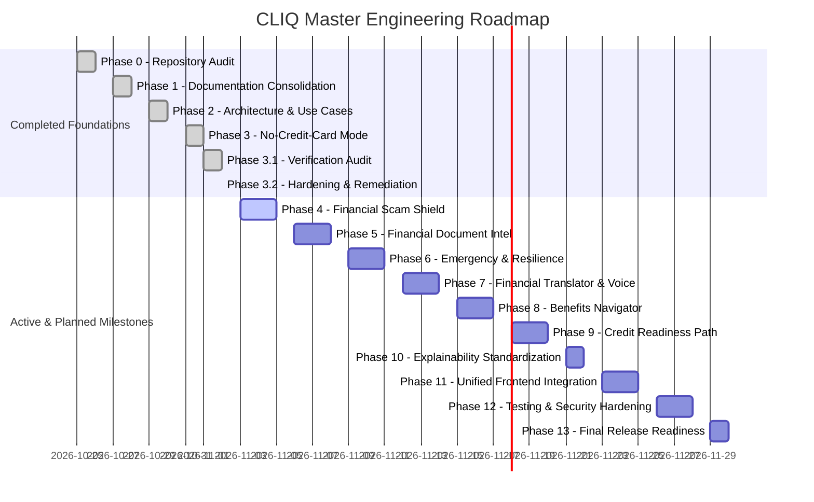

# CLIQ — Master Engineering Roadmap (Phases 0 to 13)

This document presents the complete 14-phase engineering roadmap for CLIQ, marking current progress, phase dependencies, and deliverables.

---

## 1. Master Execution Timeline

---

## 2. Phase-by-Phase Roadmap Details

| Phase | Milestone Name | Scope & Key Deliverables | Status |
| :---: | :--- | :--- | :---: |
| **0** | **Repository Audit** | Source code inspection, model discovery, test suite analysis, baseline architecture report. | **COMPLETED** |
| **1** | **Documentation Consolidation** | 48 Markdown docs synthesized into 11 canonical files. Link verification. | **COMPLETED** |
| **2** | **Architecture & Use Cases** | Financial inclusion architecture, dual-pathway system design, shared core. | **COMPLETED** |
| **3** | **No-Credit-Card Mode** | Incomes entity, cash flow API, budget planner, CLIQ Learn academy, UI adaptation. | **COMPLETED** |
| **3.1**| **Verification Audit** | Adversarial inspection of Phase 3 code. Identified DEF-01 through DEF-09. | **COMPLETED** |
| **3.2**| **Remediation & Hardening** | Resolved DEF-01 to DEF-09, Alembic migrations, verified 42 frontend tests. | **COMPLETED** |
| **4** | **Financial Scam Shield** | **NEXT MILESTONE.** Deceptive merchant detection, phishing link heuristics, subscription trap alerts, scam scoring API. | **PENDING START** |
| **5** | **Document Intelligence** | Client-side OCR parsing for scanned paper receipts, statement tables, circular analysis. | Planned |
| **6** | **Emergency & Resilience** | Emergency runway calculator, essential vs discretionary segregation, resilience index. | Planned |
| **7** | **Translator & Voice** | Plain-language bank term translator widget, Web Speech API audio narration. | Planned |
| **8** | **Benefits Navigator** | Centralized government welfare scheme database, demographic eligibility matcher. | Planned |
| **9** | **Credit Readiness Path** | Step-by-step credit readiness index, secured card simulator, credit score tutor. | Planned |
| **10**| **Explainability Engine** | Standardize explainability payloads across all endpoints with provenance tags. | Planned |
| **11**| **Unified Frontend** | Responsive polish, accessibility audit (WCAG AA), dark/light theme consistency. | Planned |
| **12**| **Security & Evaluation** | Penetration testing, IDOR stress tests, automated benchmarks, load testing. | Planned |
| **13**| **Release Readiness** | Production deployment configurations, Docker manifests, user user guides. | Planned |

---

## 3. Scope & Requirements for Phase 4 (Next Active Milestone)

When the user authorizes Phase 4, Claude should execute:
1. **Scam Detection Engine (`app/services/security/scam_shield.py`):**
   - Check merchant strings against similarity distances for known banking and utility spoofing patterns.
   - Flag payment request texts containing urgent psychological lures ("electricity disconnected tonight", "KYC expired", "instant lottery prize").
   - Flag recurring transactions originating from zero-cost introductory trial subscriptions.
2. **Scam Scoring API (`/api/v1/security/scam-check`):**
   - Input: transaction text, merchant name, amount, payment method.
   - Output: threat score (0 to 100), risk tier (`LOW`, `MEDIUM`, `HIGH`), specific scam flags, and recommended safety precautions.
3. **Frontend Integration:**
   - Visual alert banner on `/dashboard` and `/transactions` for flagged transactions.
   - "Verify Merchant / Scam Check" tool in CLIQ Assistant and Learn tabs.

