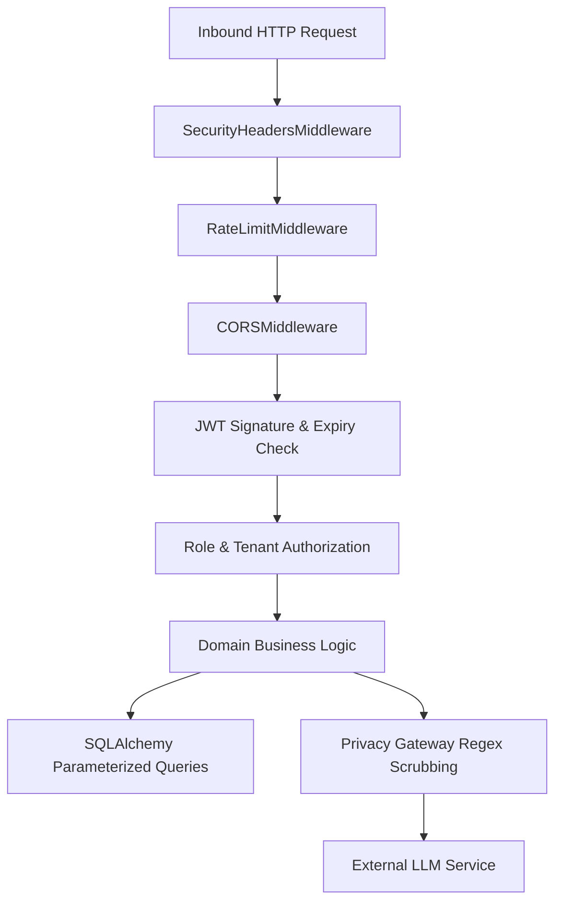
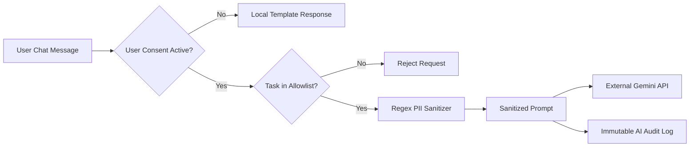

# CLIQ — Security, Privacy & Data Isolation Architecture

This document details the security model, tenant isolation mechanisms, PII redaction rules, and cryptographic boundaries protecting CLIQ.

---

## 1. Threat Model & Defense In Depth

CLIQ implements a multi-layer defense-in-depth model:



---

## 2. Authentication & Credential Security

1. **Password Hashing:**
   - Handled via `passlib.context.CryptContext(schemes=["bcrypt"], deprecated="auto")`.
   - Passwords undergo cryptographic salt generation and work factor stretching.
   - Raw passwords are never logged, stored, or exposed in API responses.

2. **JWT Authentication:**
   - Signed using `HS256` with a strong server-side `SECRET_KEY`.
   - Access tokens expire after `ACCESS_TOKEN_EXPIRE_MINUTES` (default: **10080 minutes = 7 days**). Note: No refresh token mechanism exists yet; this long expiry is a deliberate product decision for development ergonomics. Refresh tokens are planned for a future hardening phase.
   - Payload schema:
     ```json
     {
       "sub": "user-uuid-v4",
       "email": "user@example.com",
       "role": "USER",
       "exp": 1730563200
     }
     ```
   - Enforced by FastAPI dependency `get_current_user` in `backend/app/security/dependencies.py`.

---

## 3. Tenant Isolation & IDOR Defense

Insecure Direct Object Reference (IDOR) attacks represent the primary threat in personal finance platforms. CLIQ protects against cross-tenant data leaks through architectural conventions:

1. **Strict User Scoping:**
   - Every read, update, or delete operation on `transactions`, `credit_cards`, `incomes`, `user_budgets`, `uploaded_documents`, `user_preferences`, or `user_learning_progress` MUST append:
     ```python
     .where(Entity.user_id == current_user.id)
     ```
2. **Deterministic HTTP 404:**
   - When a user queries an entity ID that does not exist or belongs to another tenant, the backend raises HTTP 404 Not Found rather than HTTP 403, preventing resource enumeration.
3. **Foreign Key Integrity:**
   - In cross-user testing (e.g. `test_ai_data_egress_audit.py`), foreign key constraints prevent orphan records or cross-tenant references.

---

## 4. Privacy Gateway & AI Data Protection

The Privacy Gateway (`backend/app/services/privacy/privacy_gateway.py`) sits between user interactions and any external AI provider (Google Gemini):



### 4.1 Indian PII Redaction Regex Suite

The Privacy Gateway executes **9 pre-compiled regular expressions** against all prompt context before any data leaves the system:

| # | PII Category | Replacement Token |
| :--- | :--- | :--- |
| 1 | **Payment Card (16-digit)** | `[REDACTED_CARD_NUMBER]` |
| 2 | **CVV (3-digit security code)** | `[REDACTED_CVV]` |
| 3 | **OTP / PIN (4–8 digit codes)** | `[REDACTED_OTP_PIN]` |
| 4 | **Aadhaar Number** | `[REDACTED_AADHAAR]` |
| 5 | **Income Tax PAN Card** | `[REDACTED_TAX_PAN]` |
| 6 | **Bank Account Number (9–18 digits)** | `[REDACTED_BANK_ACCOUNT]` |
| 7 | **Email Address** | `[REDACTED_EMAIL]` |
| 8 | **Phone Number (India)** | `[REDACTED_PHONE]` |
| 9 | **Auth Tokens (Bearer/JWT strings)** | `[REDACTED_AUTH_TOKEN]` |

> **Note on UPI ID:** UPI ID redaction is planned but not yet implemented — it is intentionally excluded because the `[a-zA-Z0-9_.-]+@[a-zA-Z0-9]+` pattern overlaps too broadly with email addresses and legitimate financial context identifiers, causing over-redaction.

### 4.2 User Consent Ledger (`user_ai_consents`)
- External AI features are **Opt-In** (`external_ai_enabled: False` by default).
- Users configure granular sub-consents:
  - `allow_card_context: bool` (permits sending card names and reward tier metadata).
  - `allow_spending_context: bool` (permits sending aggregated category spend numbers, but never raw merchant names).
- If consent is toggled off, AI queries are routed to local deterministic response templates.

### 4.3 Immutable AI Request Audit Log (`ai_request_audit_logs`)
Every AI dispatch logs:
- `request_id` (UUIDv4)
- `user_id`
- `task_type` (`FINANCIAL_ADVICE`, `EXPLAINABILITY`, `TRANSLATION`)
- `data_classification` (`CONFIDENTIAL`, `RESTRICTED`, `PUBLIC`)
- `provider` (`GEMINI`)
- `redaction_count` (number of PII tokens stripped)
- `redacted_types_json` (array of PII types detected)
- `latency_ms`, `prompt_tokens`, `completion_tokens`

---

## 5. Security Headers & Rate Limiting

- **Rate Limiting:** Managed in-memory by `RateLimitMiddleware`. Effective limit is set by `RATE_LIMIT_PER_MINUTE` config (default in `config.py`: **600 req/min**; `.env.example` local override: **120 req/min**). Limit violations return HTTP 429 Too Many Requests.
- **Security Headers** (6 headers injected by `SecurityHeadersMiddleware`):
  - `X-Content-Type-Options: nosniff`
  - `X-Frame-Options: DENY`
  - `X-XSS-Protection: 1; mode=block`
  - `Strict-Transport-Security: max-age=31536000; includeSubDomains`
  - `Content-Security-Policy: default-src 'self' ...`
  - `Referrer-Policy: strict-origin-when-cross-origin`

---

## 6. Known Security Boundaries & Guidelines

- **No Secrets in Repo:** All API keys and database credentials reside exclusively in local uncommitted `.env` files. Handover documentation contains zero active credentials.
- **Zero Raw Account Storage:** CLIQ stores only card nicknames, banks, networks, and the last 4 digits. Full card numbers, CVVs, expiry dates, and bank account credentials are NEVER requested or stored.

