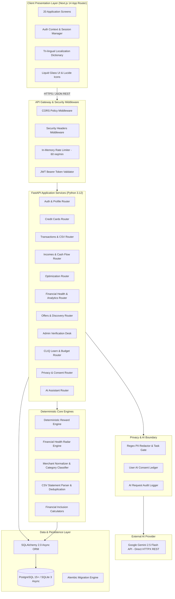
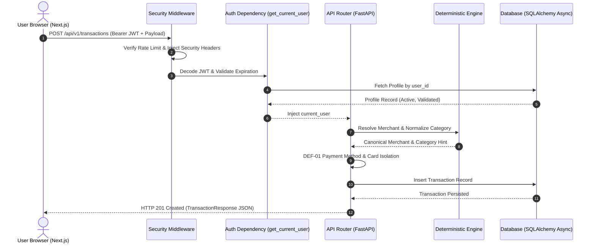
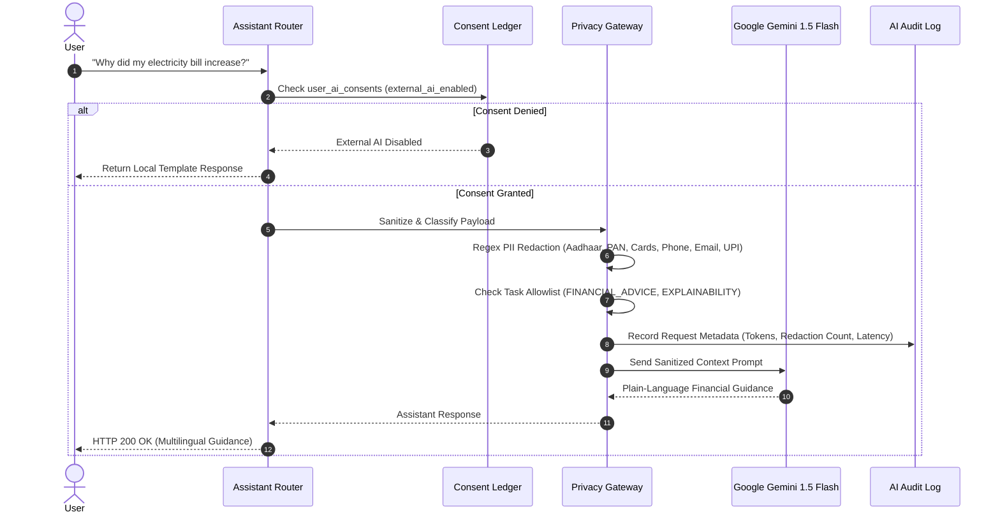

# CLIQ — System Architecture & Data Flow

This document details the complete end-to-end system architecture, component boundaries, execution lifecycles, and security gates of the CLIQ platform.

---

## 1. High-Level Architectural Blueprint

---

## 2. Component Boundaries & Responsibilities

### 2.1 Client Presentation Layer
- **Framework:** Next.js 14.2.4 using the App Router.
- **Rendering Model:** Prerendered static client layouts (`"use client"`) communicating with FastAPI over HTTPS via standard `fetch`.
- **Authentication State:** Client-side bearer token synchronization in `localStorage` backed by custom window event dispatchers (`auth-state-change`) to prevent out-of-sync session state across tabs and navigation events.
- **Styling:** Tailwind CSS with a modern design system ("Liquid Glass" aesthetic, semi-transparent frosted cards, refined dark mode contrast, zero generic UI templates).
- **Internationalization:** In-memory translation dictionary (`frontend/lib/translations.ts`) delivering instantaneous zero-network language switching across English, Hindi, and Kannada.

### 2.2 Security Gateway & Middleware
Every inbound HTTP request to the FastAPI backend traverses a pipeline of three middlewares defined in `backend/app/security/middleware.py`:
1. **`SecurityHeadersMiddleware`:**
   - Injects `X-Content-Type-Options: nosniff`.
   - Injects `X-Frame-Options: DENY`.
   - Injects `X-XSS-Protection: 1; mode=block`.
   - Injects `Strict-Transport-Security: max-age=31536000; includeSubDomains`.
   - Injects strict `Content-Security-Policy`.
   - Injects `Referrer-Policy: strict-origin-when-cross-origin`.
2. **`RateLimitMiddleware`:**
   - Enforces a sliding-window rate limit configured via `RATE_LIMIT_PER_MINUTE` (config.py default: **600 req/min**; `.env.example` local override: **120 req/min**).
   - Returns HTTP 429 Too Many Requests upon limit exhaustion.
3. **`CORSMiddleware`:**
   - Restricts cross-origin resource sharing to trusted origins configured in `settings.cors_origins`.

### 2.3 Service Layer & Domain Isolation
The business logic is partitioned cleanly into dedicated domain services:
- **`app.services.reward_optimization.engine`:** Pure deterministic mathematical calculation of credit card rewards. Never delegates calculation to an external API.
- **`app.services.financial_health.health_engine`:** Multi-factor financial health score (0 to 100) combining savings rate, expense-to-income ratio, recurring subscription burden, and credit utilization.
- **`app.services.statement_parser.csv_parser`:** Bank-specific CSV dialect parser with canonical schema normalization.
- **`app.services.statement_parser.deduplication`:** SHA-256 fingerprinting for transaction deduplication.
- **`app.services.education.calculators`:** Mathematical engines powering the 5 CLIQ Learn financial inclusion calculators.
- **`app.services.offers.discovery_pipeline`:** Multi-source offer ingestion pipeline supporting HTML scraping, partner API feeds, and manual administrative uploads.

---

## 3. Request Execution Lifecycle

---

## 4. Privacy Gateway & AI External Boundary

When a user interacts with the AI Assistant (`POST /api/v1/assistant/chat`), the request never goes directly to Google Gemini:

---

## 5. Persistence & Database Tier

- **ORM:** SQLAlchemy 2.0 using the `AsyncSession` pattern (`async with AsyncSessionLocal() as session:`).
- **Driver Abstraction:**
  - Production: `postgresql+asyncpg://...` (Supabase, AWS RDS, GCP Cloud SQL).
  - Local Development / Test: `sqlite+aiosqlite:///...` with seamless async compatibility.
- **Schema Migrations:** Managed exclusively through Alembic version scripts in `backend/alembic/versions/`. Runtime table manipulation is strictly prohibited.
- **Tenant Isolation:** Enforced via `WHERE user_id = current_user.id` on every query across transactions, incomes, credit cards, documents, budgets, and learning progress.

