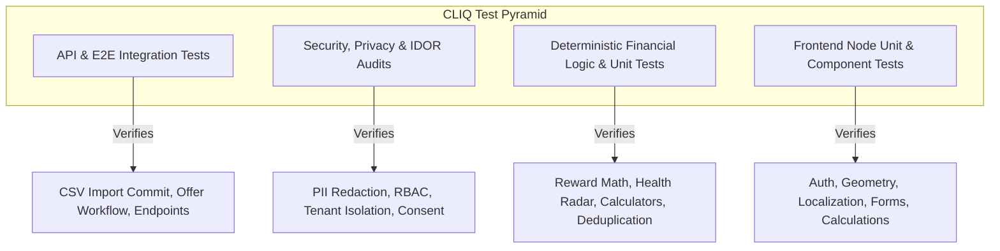

# CLIQ — Testing, Quality Assurance & Verification Catalog

This document details the test suites, verification commands, and test catalogs covering CLIQ's backend and frontend.

---

## 1. Testing Strategy Overview



---

## 2. Frontend Test Suite Catalog (42 Tests across 7 Suites)

The frontend uses Node's native test runner with TypeScript execution:
```bash
npm --prefix frontend test -- --watchAll=false
```

| Suite Name | File Location | Tests | Scope Covered |
| :--- | :--- | :---: | :--- |
| **Authentication Lifecycle** | `frontend/__tests__/auth_lifecycle.test.ts` | 6 | Login, signup, storage sync, custom event dispatch, refresh resilience, 401 logout, Bearer header injection. |
| **Card Stack Geometry** | `frontend/__tests__/card_stack_animation.test.ts` | 7 | Multi-card stack geometry, fan-out rotations (-12° to +12°), responsive boundary overflow prevention. |
| **Financial Inclusion & CLIQ Learn** | `frontend/__tests__/financial_inclusion.test.ts` | 6 | Compounding interest calculations, minimum payment traps, 50/30/20 budget allocations, 30% utilization. |
| **Multilingual Localization** | `frontend/__tests__/localization.test.ts` | 6 | Dictionary completeness, 20 sections across EN, HI, KN, zero missing keys, Devanagari/Kannada script integrity. |
| **No-Credit-Card Mode** | `frontend/__tests__/no_card_mode.test.ts` | 6 | Income frequency normalization, 90-day rolling median, cash flow deficit detection, non-card transaction payloads. |
| **Numeric Input Design** | `frontend/__tests__/numeric_input.test.ts` | 8 | Empty string initialization, prevention of leading zero traps (`'6'` not `'06'`), trailing decimal point persistence. |
| **CSV Statement Ingestion** | `frontend/__tests__/transaction_import.test.ts` | 3 | Status classification mapping, duplicate detection flags, commit payload builder. |

**Current Status:** All 42 tests passing with 0 failures (`143ms` duration).

---

## 3. Frontend Production Build Verification

Verify that all Next.js routes compile statically with zero type errors:
```bash
npm --prefix frontend run build
```
**Current Status:** Successfully compiled 23 static pages (20 application screens + 3 Next.js internal routes).

---

## 4. Backend Test Suite Catalog (20 Test Modules)

The backend uses `pytest` with `pytest-asyncio` inside the Python virtual environment:
```bash
cd backend && PYTHONPATH=. .venv/bin/pytest tests/unit/ -v
```

### 4.1 Unit Test Modules (`backend/tests/unit/`)
1. **`test_financial_inclusion.py`:** Tests curriculum categories, interest calculators, minimum due traps, 50/30/20 budgeter, utilization thresholds, break-even spend.
2. **`test_no_card_mode.py`:** Tests non-card transaction reward quarantine (DEF-01), 90-day rolling monthly median (DEF-03), one-time windfall expiry (DEF-04), empty profile 0-baseline (DEF-05), and income CRUD.
3. **`test_reward_engine.py`:** Validates deterministic reward calculation, caps, exclusions, and point-to-monetary conversion.
4. **`test_financial_health.py`:** Validates 4-pillar health scoring, recurring subscription detection, and savings rate evaluations.
5. **`test_csv_statement_parser.py`:** Tests bank statement dialect detection (HDFC, SBI, ICICI, Axis) and canonical schema mapping.
6. **`test_hybrid_offer_discovery.py`:** Tests automated offer connector discovery, duplicate content hashing, and quarantine upon material changes.
7. **`test_offer_ingestion_infrastructure.py`:** Tests PDF circular ingestion, partner API feeds, manual offer creation, and source health tracking.
8. **`test_multilingual_assistant.py`:** Tests multilingual response generation in Hindi, Kannada, and English.
9. **`test_purchase_intelligence.py`:** Tests purchase advisor ranking and alternative comparison generation.
10. **`test_wallet_offers_utilization.py`:** Tests matching discovered bank offers to user card wallets.

### 4.2 Security & Privacy Test Modules (`backend/tests/security/`)
1. **`test_privacy_gateway.py`:** Verifies regex redaction across Indian Aadhaar, PAN, Card, Phone, Email, and UPI tokens.
2. **`test_ai_data_egress_audit.py`:** Cross-user data isolation test, tenant isolation checks, consent ledger checks, and audit logging.
3. **`test_authentication_lifecycle.py`:** JWT creation, expiry checks, password hashing, and token invalidation.
4. **`test_security_audit.py`:** RBAC authorization boundaries, rate limiting middleware, security headers.
5. **`test_extended_audit.py`:** Edge cases in authentication, invalid credentials, and malformed authorization headers.
6. **`test_gemini_smoke_test.py`:** External LLM integration test (requires active network).

### 4.3 API & Integration Test Modules (`backend/tests/api/`, `tests/integration/`)
1. **`test_e2e_flow.py`:** End-to-end registration, card addition, transaction logging, and reward retrieval.
2. **`test_purchase_intelligence_flow.py`:** End-to-end recommendation flow.
3. **`test_transaction_import_flow.py`:** CSV upload preview, deduplication hash checking, and batch commit flow.
4. **`test_supabase_postgres_integration.py`:** Live Supabase PostgreSQL connection and migration test (requires active network).

