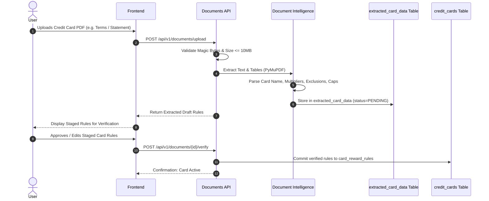

# CLIQ AI Architecture & Intelligence Pipeline

## 1. Architectural Philosophy: Deterministic Computation vs. AI Assistance

A fundamental design rule in CLIQ is the **Separation of Computation and Conversation**:

| Capability | Engine Responsible | Rationale |
|---|---|---|
| Reward calculation | **Deterministic Python Engine** | Financial calculations must be exact, 100% reproducible, and auditable using `Decimal`. |
| Cap & exclusion enforcement | **Deterministic Python Engine** | Business rules and regulatory conditions cannot be left to probabilistic guesswork. |
| Ranking & comparisons | **Deterministic Python Engine** | Ranking must be mathematically proven based on net yield. |
| PDF statement understanding | **Document Intelligence Engine** | Extracts unstructured tables and clauses into structured Pydantic models. |
| Human verification | **User Review Gate** | AI-extracted rules are staged and never activated without human sign-off. |
| Multilingual conversational Q&A | **Language Intelligence Engine** | Translates financial insights into user-friendly English, Hindi, and Kannada. |
| Spending habit explanations | **Explainable Insights Engine** | Translates execution logs into clear, actionable prose. |

---

## 2. LLM Provider Abstraction

CLIQ implements a provider-agnostic interface (`AIProvider` protocol) supporting multiple backends:
- **Google Gemini** (`gemini-2.5-flash` via official SDK, configurable via `AI_MODEL_NAME` or `GEMINI_MODEL`)
- **OpenAI** (`gpt-4o-mini`, `gpt-4o`)
- **Anthropic** (`claude-3-5-sonnet`)
- **Local Fallback Heuristic Engine:** Operates without external API keys, ensuring CLIQ remains completely functional offline or during development with rich grounded responses in English, Hindi, and Kannada.

---

## 3. Document Intelligence Pipeline

---

## 4. Multilingual Language Intelligence Engine

CLIQ natively supports:
- **English (`en`)**
- **Hindi (`hi`)** — e.g. "मेरी कौन सी कार्ड से स्विगी पर ज्यादा कैशबैक मिलेगा?"
- **Kannada (`kn`)** — e.g. "ಸ್ವಿಗ್ಗಿಯಲ್ಲಿ ಯಾವ ಕಾರ್ಡ್ ಬಳಸಿದರೆ ಹೆಚ್ಚು ಕ್ಯಾಶ್‌ಬ್ಯಾಕ್ ಸಿಗುತ್ತದೆ?"

### Grounded Context Injection
When a user asks a question:
1. The engine retrieves the user's active credit card portfolio, reward rules, and spending history from the database.
2. The user query and context are structured into a grounded prompt:
   - "You are CLIQ's Financial Assistant. Respond ONLY using the provided verified card details. Do NOT invent cards or reward percentages."
3. The response is returned in the requested language along with traceable citations pointing to the user's specific card policies.
