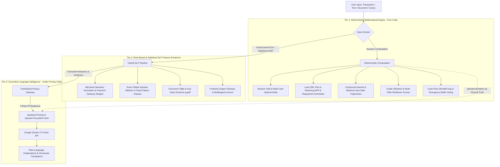
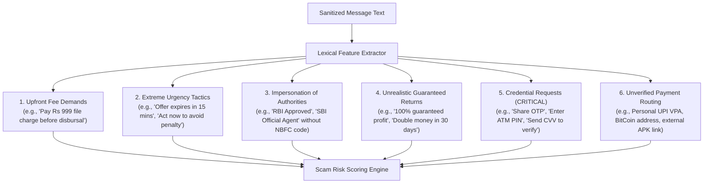

# CLIQ — AI, Machine Learning & NLP Architecture
## Universal Financial Intelligence & Language Processing

> **Release Target:** v0.4.0 Blueprint  
> **Core Principle:** Strict Separation of Deterministic Math and Probabilistic Natural Language Processing  
> **Primary NLP Provider:** Google Gemini 2.5 Flash (`google-genai` SDK) via Centralized Privacy Gateway  
> **Hybrid Pipelines:** Regex Sanitizers · Rule-Based NLP Extractors · Lexical Fraud Pattern Matchers · Grounded LLM Explanations

---

## 1. Architectural Philosophy: The Three Computational Tiers

In financial intelligence, blending probabilistic generation with mathematical calculation causes severe risks. An LLM must never compute interest rates, loan EMIs, spend caps, or credit utilization.

CLIQ enforces a **three-tier intelligence hierarchy**:

---

## 2. Advanced NLP & Intelligence Services

### 2.1 Financial Scam Shield Engine (`app/services/scam_shield/`)
The Financial Scam Shield analyzes user-provided financial communications (SMS forwards, WhatsApp messages, digital loan advertisements, and promotional emails) to detect deceptive and predatory practices.

#### A. Input & Privacy Pipeline
- **Explicit User Action:** Analysis executes **only** when a user deliberately pastes text into the Scam Shield interface. CLIQ never silently accesses device SMS or WhatsApp messages.
- **Pre-Analysis Sanitization:** The text is passed through the Privacy Gateway to mask user phone numbers, recipient names, and personal UPI IDs before pattern matching.

#### B. 6 Core Scam Risk Indicator Classes
The engine executes multi-pattern regular expressions and lexical matching across six distinct fraud vectors:

#### C. Four-Tier Risk Classification & Scoring
The engine aggregates detected pattern weights into a risk score (0–100) and assigns an actionable risk tier:
1. **`HIGH_RISK` (Score 75–100):** Immediate red flag (e.g. credential request, upfront fee demand, unverified APK download).
2. **`SUSPICIOUS` (Score 50–74):** Multiple suspicious indicators (e.g. urgency tactics paired with unverified lender claims).
3. **`NEEDS_VERIFICATION` (Score 25–49):** Legitimate bank offer characteristics combined with ambiguous terms or missing disclosures.
4. **`NO_OBVIOUS_INDICATORS` (Score 0–24):** Standard transactional or informational message with no recognized predatory indicators.

#### D. Non-Negotiable Scam Shield Guardrails
- **No False Safety Guarantees:** The engine never declares a message "100% Safe" or "Guaranteed Legitimate". If no risks are found, it outputs: *"No obvious scam indicators were detected in this snippet. However, always verify directly through official bank channels before sending money or sharing details."*
- **Verbatim Evidence Anchors:** Every flagged indicator must cite the exact substring from the user's message that triggered the rule.
- **Official Remediation Guidance:** High-risk outputs provide direct guidance to verify NBFC registrations via the **RBI Sachet Portal** (`sachet.rbi.org.in`) and report cyber fraud to `cybercrime.gov.in` (Helpline: 1930).

---

### 2.2 Financial Document Intelligence Engine (`app/services/document_service.py`)
Expands basic credit card PDF parsing into a comprehensive financial document inspection suite supporting bank statements, loan sanction letters, and credit agreements.

#### A. Document Parsing Pipeline
- **Digital PDFs:** Utilizes `pypdf` for direct text and table coordinate extraction.
- **Scanned Documents (OCR Evaluation):** Evaluates document rasterization quality; uses open-source Tesseract OCR / TrOCR for optical character recognition when embedded text streams are absent.
- **Human-in-the-Loop Staging:** Extracted contractual terms are placed in a `pending_verification` state for user confirmation.

#### B. Loan Entity Extraction & Flat vs. Reducing APR Discrepancy
Lenders frequently market misleading "Flat Interest Rates" that disguise the true compounding cost of debt. CLIQ extracts key loan parameters and performs closed-form mathematical reconciliation:

$$\text{Monthly EMI (Reducing Balance)} = P \times \frac{r(1+r)^n}{(1+r)^n - 1}$$

Where $P$ is principal, $r$ is monthly interest rate, and $n$ is total months.

| Extracted Parameter | Example in Sanction Letter | CLIQ Extraction & Analysis |
| :--- | :--- | :--- |
| **Principal Amount ($P$)** | "Sanctioned Loan: ₹2,00,000" | Verified principal. |
| **Nominal Rate (Claimed)** | "Special Interest Rate: 12% Flat" | Flagged: "Flat interest ignores declining principal." |
| **True Reducing APR ($r_{\text{eff}}$)** | Not disclosed in marketing text | **Computed by CLIQ: 21.8% Effective APR.** |
| **Processing Fees & Charges** | "Processing Fee: 2.5% + GST" | Computes deducted net disbursal: ₹194,100. |
| **Penal Charges & Foreclosure** | "Prepayment penalty: 4%" | Flags restrictive lock-in clauses. |

---

### 2.3 CLIQ Financial Translator & Vernacular Voice
Extends CLIQ's language capabilities from text generation into interactive financial terminology translation and voice guidance.

#### A. Simple-Language Financial Jargon Dictionary
Transforms opaque banking terms into intuitive Indian metaphors across English, Hindi (`हिन्दी`), and Kannada (`ಕನ್ನಡ`):

| Banking Term | English Vernacular Explanation | Hindi Translation & Explanation | Kannada Translation & Explanation |
| :--- | :--- | :--- | :--- |
| **APR** (Annual Percentage Rate) | The total yearly cost of borrowing, including interest and compulsory bank fees. | **वार्षिक ब्याज दर:** एक साल में लोन पर लगने वाला कुल ब्याज और फीस। | **ವಾರ್ಷಿಕ ಬಡ್ಡಿದರ:** ಸಾಲದ ಮೇಲೆ ವರ್ಷಕ್ಕೆ ತಗಲುವ ಒಟ್ಟು ಬಡ್ಡಿ ಮತ್ತು ಬ್ಯಾಂಕ್ ಶುಲ್ಕ. |
| **Compound Interest** | Interest charged not just on your original debt, but also on the unpaid interest already added. | **चक्रवृद्धि ब्याज:** मूलधन के साथ-साथ पिछले ब्याज पर भी लगने वाला ब्याज। | **ಚಕ್ರಬಡ್ಡಿ:** ಅಸಲಿನ ಜೊತೆಗೆ ಸಂಗ್ರಹವಾದ ಬಡ್ಡಿಯ ಮೇಲೂ ಬೀಳುವ ಬಡ್ಡಿ. |
| **Grace Period** | The interest-free window (usually 20–50 days) between your purchase and the bill payment due date. | **ब्याज-मुक्त अवधि:** खरीदारी और बिल भरने की आखिरी तारीख के बीच का समय। | **ಬಡ್ಡಿ ರಹಿತ ಅವಧಿ:** ಖರೀದಿ ಮತ್ತು ಬಿಲ್ ಪಾವತಿಯ ಗಡುವಿನ ನಡುವಿನ ಸಮಯ. |
| **Moratorium** | A temporary pause on loan EMI payments granted during financial distress (interest still accumulates). | **भुगतान स्थगन:** लोन की किस्तों को कुछ समय के लिए रोकने की मोहलत। | **ಪಾವತಿ ಮುಂದೂಡಿಕೆ:** ಸಾಲದ ಕಂತುಗಳನ್ನು ತಾತ್ಕಾಲಿಕವಾಗಿ ಮುಂದೂಡುವ ಅವಕಾಶ. |

#### B. Audio Privacy & Speech Architecture
- **Client-Side Speech-to-Text:** Utilizes the Web Speech API in supported browsers, ensuring voice recordings never leave the client device.
- **Ephemeral Audio Fallback:** If server-side transcription is required, audio buffers are processed ephemerally in RAM and immediately zeroized following text extraction. Audio files are never written to disk or used for training.
- **Explicit Voice Consent:** Voice capabilities require an explicit `allow_voice_input` flag in `UserAiConsent`.

---

## 3. Reality vs. Roadmap: Universal Platform Capabilities

| Capability | Current State in v0.3.0 | Status in v0.4.0 Architecture | Implementation Strategy |
| :--- | :--- | :--- | :--- |
| **Credit Card Reward Optimization** | Fully Implemented | Maintained (Path A Core) | Pure Deterministic Engine (`reward_engine.py`) |
| **Merchant Normalization** | Fully Implemented | Maintained (Shared Core) | Rule-Based Regex + Registry Matching |
| **CLIQ Learn & 5 Calculators** | Fully Implemented | Expanded to Credit Readiness | Deterministic Math (`curriculum_data.py`) |
| **Centralized Privacy Gateway** | Fully Implemented | Expanded (Scam Shield & Audio) | 9-Rule Regex Pipeline (`privacy_gateway.py`) |
| **Grounded Gemini 2.5 Flash** | Fully Implemented | Expanded to Translator | Context Injection + Offline Fallback |
| **No-Credit-Card Cash-Flow Mode** | *Phase 3 Target* | Designed & Architected | Incomes CRUD, Budgets, Zero-Card Isolation |
| **Financial Scam Shield** | *Phase 4 Target* | Designed & Architected | Hybrid NLP (6 Pattern Classes + Gemini Explanation) |
| **Loan Document Intelligence** | *Phase 5 Target* | Designed & Architected | pypdf + Flat-to-Reducing APR Math |
| **Emergency Shortfall Estimator** | *Phase 6 Target* | Designed & Architected | Deterministic Cash-Flow Gap Projection |
| **Financial Benefits Navigator** | *Phase 8 Target* | Designed & Architected | Verified Government Scheme Directory |
| **Supervised ML Categorizer** | Planned (Sprint 2) | Future Milestone | LightGBM on Indian transaction corpus |
| **Isolation Forest Anomaly Model** | Planned (Sprint 3) | Future Milestone | Unsupervised statistical z-score outlier detection |
