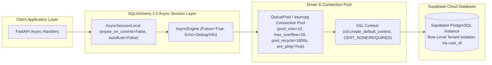
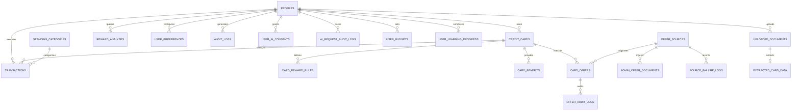

# CLIQ — Relational Database Architecture & Design Specification

> **Status:** Production Specification (v0.3.0)  
> **ORM Engine:** SQLAlchemy 2.0 Async (`async_sessionmaker`, `Mapped`, `mapped_column`)  
> **Production Target:** Supabase PostgreSQL (`postgresql+asyncpg://`, SSL Require, Connection Pooling)  
> **Development / Testing Fallback:** Asynchronous SQLite (`sqlite+aiosqlite:///`)

---

## 1. Database Architecture & Connection Management

The CLIQ persistence layer provides robust ACID compliance, referential integrity, and tenant isolation across all 20 relational entities.

### Connection Pool Configuration (`app/core/database.py`)
- **Dialect Normalization:** Transparently rewrites `postgresql://` or `postgres://` to `postgresql+asyncpg://`.
- **Pool Sizing:**
  - `pool_size`: 10 persistent connections per worker.
  - `max_overflow`: 20 burst connections for high-throughput traffic.
  - `pool_recycle`: 1,800 seconds (30 minutes) to eliminate stale socket disconnections.
  - `pool_pre_ping`: `True` (verifies connection liveness with `SELECT 1` prior to checkout).
- **SSL Security:** Dedicated SSL context configured for encrypted cloud communication.

---

## 2. Complete Entity-Relationship Overview (20 Entities)

---

## 3. Comprehensive Entity Dictionary (All 20 Tables)

### 3.1 User & Identity Domain

#### 1. `profiles`
Primary user identity entity, supporting both standard email/password authentication and Supabase auth synchronizations.
- `id` (VARCHAR(36), PK): UUID v4 unique identifier.
- `email` (VARCHAR(255), Unique, Not Null, Indexed): User email address.
- `hashed_password` (VARCHAR(255), Not Null): Bcrypt hashed password.
- `full_name` (VARCHAR(255), Nullable): User full display name.
- `financial_pathway` (ENUM('CREDIT_CARD', 'NO_CREDIT_CARD'), Default 'CREDIT_CARD', Not Null): Dedicated financial mode separating credit-card optimizers from cash/UPI/budgeting users.
- `preferred_language` (VARCHAR(10), Default 'en', Not Null): Localization code ('en', 'hi', 'kn', etc.).
- `currency` (VARCHAR(10), Default 'INR', Not Null): Monetary display symbol.
- `role` (VARCHAR(32), Default 'USER', Not Null): RBAC role ('USER', 'ADMIN').
- `is_admin` (BOOLEAN, Default False, Not Null): Administrative privilege flag.
- `is_active` (BOOLEAN, Default True, Not Null): Soft deletion and account suspension flag.
- `created_at` (TIMESTAMP, Default UTC Now, Not Null)
- `updated_at` (TIMESTAMP, Default UTC Now, On Update UTC Now, Not Null)

#### 2. `user_preferences`
Optimization objectives and calculation preferences.
- `id` (VARCHAR(36), PK)
- `user_id` (VARCHAR(36), FK -> `profiles.id`, Unique, Not Null, Cascade Delete)
- `prioritize_cashback` (BOOLEAN, Default True, Not Null)
- `prioritize_miles` (BOOLEAN, Default False, Not Null)
- `include_annual_fee_in_net` (BOOLEAN, Default False, Not Null)
- `monthly_spend_target` (NUMERIC(12, 2), Nullable)
- `created_at` / `updated_at` (TIMESTAMP)

#### 3. `user_budgets`
Category-specific spending budgets and income references.
- `id` (VARCHAR(36), PK)
- `user_id` (VARCHAR(36), FK -> `profiles.id`, Unique, Not Null, Cascade Delete, Indexed)
- `monthly_income` (NUMERIC(12, 2), Nullable): Baseline monthly earnings.
- `total_budget` (NUMERIC(12, 2), Not Null): Aggregate monthly expense ceiling.
- `category_budgets_json` (TEXT, Default '{}', Not Null): JSON map of `category_id` $\to$ allocation in INR.
- `created_at` / `updated_at` (TIMESTAMP)

#### 4. `user_learning_progress`
Tracks lesson completions and quiz scores within the CLIQ Learn inclusion curriculum.
- `id` (VARCHAR(36), PK)
- `user_id` (VARCHAR(36), FK -> `profiles.id`, Not Null, Cascade Delete, Indexed)
- `topic_id` (VARCHAR(64), Not Null, Indexed): Curriculum identifier.
- `category_id` (VARCHAR(64), Not Null): Topic category ('fundamentals', 'debt', 'score', etc.).
- `is_completed` (BOOLEAN, Default False, Not Null)
- `quiz_score` (INTEGER, Nullable): Score achieved on topic quiz (0–100).
- `completed_at` (TIMESTAMP, Nullable)
- `created_at` / `updated_at` (TIMESTAMP)

#### 5. `incomes`
Tracks regular and irregular income streams for No-Credit-Card mode cash-flow and resilience analytics.
- `id` (VARCHAR(36), PK): UUID v4 identifier.
- `user_id` (VARCHAR(36), FK -> `profiles.id`, Not Null, Cascade Delete, Indexed): Tenant owner.
- `source_name` (VARCHAR(128), Not Null): Income stream name (e.g. Salary, Consulting, Rental, Gig).
- `amount` (NUMERIC(12, 2), Not Null): Inflow amount per cycle.
- `currency` (VARCHAR(3), Default 'INR', Not Null): ISO currency code.
- `frequency` (VARCHAR(32), Default 'MONTHLY', Not Null): 'MONTHLY', 'BI_WEEKLY', 'WEEKLY', 'IRREGULAR', 'ONE_TIME'.
- `is_irregular` (BOOLEAN, Default False, Not Null): Identifies variable contractor income.
- `received_date` (DATE, Not Null, Indexed `ix_incomes_received_date`): Exact receipt date used for calendar-month bucketing.
- `expected_date` (DATE, Nullable): Projected arrival date for expected cash flow.
- `notes` (VARCHAR(255), Nullable): Optional metadata.
- `created_at` / `updated_at` (TIMESTAMP)

---

### 3.2 Credit Card & Portfolio Domain

#### 5. `credit_cards`
User credit card portfolio. Strictly excludes sensitive PAN, CVV, or full card numbers.
- `id` (VARCHAR(36), PK)
- `user_id` (VARCHAR(36), FK -> `profiles.id`, Not Null, Cascade Delete, Indexed)
- `card_name` (VARCHAR(128), Not Null): e.g. "HDFC Regalia Gold", "Axis Ace".
- `bank_name` (VARCHAR(128), Not Null): e.g. "HDFC Bank", "ICICI Bank".
- `network` (VARCHAR(32), Default 'VISA', Not Null): 'VISA', 'MASTERCARD', 'AMEX', 'RUPAY', 'DINERS'.
- `card_type` (VARCHAR(32), Default 'CREDIT', Not Null): 'CREDIT', 'CHARGE', 'CO_BRANDED'.
- `card_variant` (VARCHAR(64), Nullable): e.g. "Metal", "Signature", "Platinum".
- `cardholder_name` (VARCHAR(128), Nullable)
- `nickname` (VARCHAR(128), Nullable)
- `last_four_digits` (VARCHAR(4), Nullable): Masked display identifier.
- `joining_fee` (NUMERIC(10, 2), Default 0.00, Not Null)
- `annual_fee` (NUMERIC(10, 2), Default 0.00, Not Null)
- `renewal_waiver_spend` (NUMERIC(12, 2), Nullable): Spend threshold for annual fee waiver.
- `fee_waiver_condition_details` (VARCHAR(255), Nullable)
- `renewal_date` (TIMESTAMP, Nullable)
- `billing_cycle_day` (INTEGER, Nullable): Day of month statement is generated (1–31).
- `terms_source_url` (VARCHAR(512), Nullable): Official bank schedule of charges link.
- `is_active` (BOOLEAN, Default True, Not Null)
- `created_at` / `updated_at` (TIMESTAMP)

#### 6. `card_reward_rules`
Fine-grained deterministic rules governing reward accrual, exclusions, and spend caps.
- `id` (VARCHAR(36), PK)
- `card_id` (VARCHAR(36), FK -> `credit_cards.id`, Not Null, Cascade Delete, Indexed)
- `category_id` (VARCHAR(64), Nullable, Indexed): Spending category ('dining', 'fuel', 'all', etc.).
- `merchant_pattern` (VARCHAR(128), Nullable): Merchant regex or substring match (e.g. 'Amazon', 'Swiggy').
- `reward_type` (VARCHAR(32), Default 'CASHBACK', Not Null): 'CASHBACK', 'REWARD_POINTS', 'MILES'.
- `reward_rate_percentage` (NUMERIC(5, 2), Not Null): Percentage yield (e.g., 5.00 for 5%).
- `point_monetary_value` (NUMERIC(6, 4), Default 1.0000, Not Null): INR value per point (e.g., 0.25).
- `min_transaction_amount` (NUMERIC(10, 2), Default 0.00, Not Null)
- `max_reward_per_transaction` (NUMERIC(10, 2), Nullable)
- `monthly_cap_amount` (NUMERIC(10, 2), Nullable): Maximum monetary reward in a billing cycle.
- `is_excluded` (BOOLEAN, Default False, Not Null): When true, explicitly yields 0% rewards.
- `exclusion_reason` (VARCHAR(255), Nullable): e.g. "Fuel surcharge exemption", "Government taxes excluded".
- `created_at` / `updated_at` (TIMESTAMP)

#### 7. `card_benefits`
Perks, complementary lounge access, insurance, and milestones.
- `id` (VARCHAR(36), PK)
- `card_id` (VARCHAR(36), FK -> `credit_cards.id`, Not Null, Cascade Delete, Indexed)
- `benefit_type` (VARCHAR(64), Not Null): 'LOUNGE_ACCESS', 'INSURANCE', 'GOLF', 'MILESTONE', etc.
- `title` (VARCHAR(255), Not Null)
- `description` (TEXT, Not Null)
- `applicable_category` (VARCHAR(64), Default 'all', Not Null)
- `annual_value_estimate` (NUMERIC(10, 2), Default 0.00, Not Null)
- `created_at` / `updated_at` (TIMESTAMP)

---

### 3.3 Transaction & Analytics Domain

#### 8. `spending_categories`
Master standard categories for transaction classification.
- `id` (VARCHAR(64), PK): e.g. 'dining', 'grocery', 'travel', 'utility', 'shopping', 'fuel', 'entertainment'.
- `display_name_en` (VARCHAR(128), Not Null)
- `display_name_hi` (VARCHAR(128), Not Null)
- `display_name_kn` (VARCHAR(128), Not Null)
- `icon_name` (VARCHAR(64), Not Null)

#### 10. `transactions`
Normalized transaction log populated manually or via CSV import.
- `id` (VARCHAR(36), PK)
- `user_id` (VARCHAR(36), FK -> `profiles.id`, Not Null, Cascade Delete, Indexed)
- `card_id` (VARCHAR(36), FK -> `credit_cards.id`, Nullable, Cascade Set Null, Indexed): Explicitly bound credit card. Must remain NULL for non-card payment methods (`CASH`, `UPI`, `DEBIT_CARD`, `BANK_TRANSFER`, `OTHER`).
- `payment_method` (VARCHAR(32), Default 'CREDIT_CARD', Not Null): Payment rail identifier ('CREDIT_CARD', 'CASH', 'UPI', 'BANK_TRANSFER', 'DEBIT_CARD', 'OTHER').
- `category_id` (VARCHAR(64), FK -> `spending_categories.id`, Not Null, Indexed)
- `merchant_name` (VARCHAR(255), Not Null)
- `raw_narration` (VARCHAR(512), Nullable): Original statement text prior to normalization.
- `amount` (NUMERIC(12, 2), Not Null)
- `currency` (VARCHAR(10), Default 'INR', Not Null)
- `transaction_date` (TIMESTAMP, Not Null, Indexed)
- `is_recurring` (BOOLEAN, Default False, Not Null)
- `reward_earned_monetary` (NUMERIC(10, 2), Default 0.00, Not Null): Earned reward (strictly 0.00 for non-card methods).
- `potential_optimal_reward` (NUMERIC(10, 2), Default 0.00, Not Null): Maximum possible reward (0.00 for non-card methods).
- `optimal_card_id` (VARCHAR(36), Nullable)
- `notes` (TEXT, Nullable)
- `created_at` (TIMESTAMP, Default UTC Now, Not Null)

#### 10. `reward_analyses`
Audit log of optimization queries executed by users.
- `id` (VARCHAR(36), PK)
- `user_id` (VARCHAR(36), FK -> `profiles.id`, Not Null, Cascade Delete, Indexed)
- `transaction_amount` (NUMERIC(12, 2), Not Null)
- `category_id` (VARCHAR(64), Not Null)
- `merchant_name` (VARCHAR(255), Nullable)
- `recommended_card_id` (VARCHAR(36), Nullable)
- `recommended_card_name` (VARCHAR(128), Not Null)
- `expected_monetary_reward` (NUMERIC(10, 2), Not Null)
- `effective_reward_rate` (NUMERIC(5, 2), Not Null)
- `calculation_breakdown_json` (TEXT, Not Null): Serialized `CalculationStep` array.
- `alternatives_json` (TEXT, Not Null): Serialized comparison array.
- `queried_at` (TIMESTAMP, Default UTC Now, Not Null)

---

### 3.4 Document & Data Staging Domain

#### 11. `uploaded_documents`
Metadata for statement PDFs or credit card policy documents.
- `id` (VARCHAR(36), PK)
- `user_id` (VARCHAR(36), FK -> `profiles.id`, Not Null, Cascade Delete, Indexed)
- `filename` (VARCHAR(255), Not Null)
- `file_path` (VARCHAR(512), Not Null)
- `mime_type` (VARCHAR(64), Not Null)
- `file_size_bytes` (INTEGER, Not Null)
- `processing_status` (VARCHAR(32), Default 'PENDING', Not Null): 'PENDING', 'PROCESSING', 'EXTRACTED', 'VERIFIED', 'FAILED'.
- `error_message` (TEXT, Nullable)
- `uploaded_at` (TIMESTAMP, Default UTC Now, Not Null)

#### 12. `extracted_card_data`
Staging table holding extracted terms awaiting human verification.
- `id` (VARCHAR(36), PK)
- `document_id` (VARCHAR(36), FK -> `uploaded_documents.id`, Unique, Not Null, Cascade Delete)
- `user_id` (VARCHAR(36), FK -> `profiles.id`, Not Null, Cascade Delete, Indexed)
- `extracted_card_name` (VARCHAR(128), Nullable)
- `extracted_bank_name` (VARCHAR(128), Nullable)
- `extracted_network` (VARCHAR(32), Nullable)
- `extracted_annual_fee` (NUMERIC(10, 2), Nullable)
- `extracted_rules_json` (TEXT, Not Null): Serialized staged rules.
- `extracted_benefits_json` (TEXT, Nullable): Serialized staged benefits.
- `confidence_score` (NUMERIC(3, 2), Default 0.85, Not Null)
- `is_verified` (BOOLEAN, Default False, Not Null)
- `verified_at` (TIMESTAMP, Nullable)
- `created_at` (TIMESTAMP, Default UTC Now, Not Null)

---

### 3.5 Offer Discovery & Administrative Verification Domain

#### 13. `offer_sources`
Catalog of bank and merchant sources monitored for promotional offers.
- `id` (VARCHAR(36), PK)
- `source_key` (VARCHAR(64), Unique, Not Null, Indexed): e.g. "hdfc_smartbuy", "icici_culinary".
- `source_name` (VARCHAR(128), Not Null)
- `domain` (VARCHAR(128), Not Null, Indexed)
- `source_type` (VARCHAR(32), Not Null, Indexed): 'BANK', 'MERCHANT', 'NETWORK', 'PARTNER'.
- `supported_ingestion_methods_json` (TEXT, Default '[]', Not Null)
- `health_status` (VARCHAR(32), Default 'HEALTHY', Not Null): 'HEALTHY', 'DEGRADED', 'UNHEALTHY', 'DISABLED'.
- `consecutive_failure_count` (INTEGER, Default 0, Not Null)
- `last_scraped_at` / `next_eligible_scrape_at` (TIMESTAMP, Nullable)
- `created_at` / `updated_at` (TIMESTAMP)

#### 14. `admin_offer_documents`
Administrative documents (PDF circulars, promotion flyers) uploaded by administrators.
- `id` (VARCHAR(36), PK)
- `source_id` (VARCHAR(36), FK -> `offer_sources.id`, Nullable, Cascade Set Null, Indexed)
- `filename` (VARCHAR(255), Not Null)
- `file_path` (VARCHAR(512), Not Null)
- `mime_type` (VARCHAR(64), Default 'application/pdf', Not Null)
- `file_size_bytes` (INTEGER, Not Null)
- `processing_status` (VARCHAR(32), Default 'PENDING', Not Null)
- `uploaded_at` (TIMESTAMP, Default UTC Now, Not Null)

#### 15. `source_failure_logs`
Structured telemetry capturing scraper failures, bot-blocking, and timeouts.
- `id` (VARCHAR(36), PK)
- `source_id` (VARCHAR(36), FK -> `offer_sources.id`, Not Null, Cascade Delete, Indexed)
- `http_status` (INTEGER, Nullable)
- `error_type` (VARCHAR(64), Not Null, Indexed): 'WAF_BLOCKED', 'ROBOTS_DISALLOWED', 'TIMEOUT', etc.
- `error_message` (TEXT, Not Null)
- `timestamp` (TIMESTAMP, Default UTC Now, Not Null, Indexed)

#### 16. `card_offers`
Normalized promotional deals discovered or staged from partner sources.
- `id` (VARCHAR(36), PK)
- `source_id` (VARCHAR(36), FK -> `offer_sources.id`, Nullable, Cascade Set Null, Indexed)
- `card_id` (VARCHAR(36), FK -> `credit_cards.id`, Nullable, Cascade Set Null, Indexed)
- `title` (VARCHAR(255), Not Null)
- `description` (TEXT, Not Null)
- `merchant` (VARCHAR(128), Not Null, Indexed)
- `category` (VARCHAR(64), Not Null, Indexed)
- `discount_percentage` (NUMERIC(5, 2), Nullable)
- `max_discount_amount` (NUMERIC(10, 2), Nullable)
- `min_transaction_amount` (NUMERIC(10, 2), Default 0.00, Not Null)
- `coupon_code` (VARCHAR(64), Nullable)
- `terms_url` (VARCHAR(512), Nullable)
- `start_date` / `end_date` (TIMESTAMP, Nullable, Indexed)
- `status` (VARCHAR(32), Default 'PENDING_REVIEW', Not Null, Indexed): 'PENDING_REVIEW', 'APPROVED', 'REJECTED', 'EXPIRED'.
- `content_hash` (VARCHAR(64), Unique, Not Null, Indexed): SHA-256 canonical hash preventing duplicate ingestion.
- `created_at` / `updated_at` (TIMESTAMP)

#### 17. `offer_audit_logs`
Tamper-resistant audit trail recording human admin reviews of promotional deals.
- `id` (VARCHAR(36), PK)
- `offer_id` (VARCHAR(36), FK -> `card_offers.id`, Not Null, Cascade Delete, Indexed)
- `admin_id` (VARCHAR(36), FK -> `profiles.id`, Nullable, Cascade Set Null, Indexed)
- `action` (VARCHAR(32), Not Null, Indexed): 'CREATED', 'APPROVED', 'REJECTED', 'UPDATED'.
- `reason` (TEXT, Nullable)
- `timestamp` (TIMESTAMP, Default UTC Now, Not Null)

---

### 3.6 Privacy & Security Domain

#### 18. `user_ai_consents`
Granular, revocable user privacy toggles governing AI usage and context sharing.
- `id` (VARCHAR(36), PK)
- `user_id` (VARCHAR(36), FK -> `profiles.id`, Unique, Not Null, Cascade Delete, Indexed)
- `external_ai_enabled` (BOOLEAN, Default False, Not Null): Privacy by default.
- `allow_card_context` (BOOLEAN, Default False, Not Null)
- `allow_spending_context` (BOOLEAN, Default False, Not Null)
- `provider_preference` (VARCHAR(32), Default 'gemini', Not Null)
- `last_consented_at` (TIMESTAMP, Nullable)
- `created_at` / `updated_at` (TIMESTAMP)

#### 19. `ai_request_audit_logs`
Immutable compliance audit trail recording every egress payload (strictly non-PII metadata).
- `id` (VARCHAR(36), PK)
- `request_id` (VARCHAR(64), Not Null, Indexed): UUID correlating frontend and backend events.
- `user_id` (VARCHAR(36), FK -> `profiles.id`, Nullable, Cascade Set Null, Indexed)
- `task_type` (VARCHAR(64), Not Null): 'FINANCIAL_QA', 'REWARD_EXPLANATION', etc.
- `data_classification` (VARCHAR(32), Not Null): 'PUBLIC', 'INTERNAL', 'SENSITIVE', 'HIGHLY_SENSITIVE'.
- `provider` (VARCHAR(32), Not Null): 'gemini', 'mock', 'local'.
- `tokens_prompt` / `tokens_completion` (INTEGER, Default 0, Not Null)
- `latency_ms` (INTEGER, Default 0, Not Null)
- `sanitization_performed` (BOOLEAN, Default True, Not Null)
- `redacted_token_count` (INTEGER, Default 0, Not Null)
- `timestamp` (TIMESTAMP, Default UTC Now, Not Null, Indexed)

#### 20. `audit_logs`
Platform-wide administrative and security audit trail.
- `id` (VARCHAR(36), PK)
- `user_id` (VARCHAR(36), FK -> `profiles.id`, Nullable, Cascade Set Null, Indexed)
- `action` (VARCHAR(128), Not Null, Indexed): 'LOGIN', 'CARD_ADDED', 'STATEMENT_UPLOADED', 'OPTIMIZATION_RUN'.
- `ip_address` (VARCHAR(64), Nullable)
- `user_agent` (VARCHAR(255), Nullable)
- `status` (VARCHAR(32), Default 'SUCCESS', Not Null): 'SUCCESS', 'FAILURE', 'WARNING'.
- `details_json` (TEXT, Nullable)
- `timestamp` (TIMESTAMP, Default UTC Now, Not Null, Indexed)

---

## 4. Migration Strategy & Alembic Workflow

CLIQ relies on Alembic for deterministic schema version control and migrations:
1. **Migration Script Location:** `backend/alembic/versions/`.
2. **Version Tracking:** The `alembic_version` table maintains current revision status.
3. **Async Migration Runner:** Migrations execute via `alembic/env.py` configured with `async_engine_from_config`.
4. **Migration History:**
   - `70d32b55c78e_initial_schema.py`: Base 20-entity schema for identity, credit cards, transactions, offers, and AI audit logging.
   - `c1f3a2b4e5d6_add_no_card_mode_incomes_and_pathway.py`: Adds `financialpathway` PostgreSQL enum, `financial_pathway` column on `profiles`, and the `incomes` table with indexed `received_date`.
5. **Zero-Downtime Principles:**
   - Backward-compatible column additions with nullable flags or safe defaults.
   - Reversible upgrades and downgrades verified via `alembic check`.

