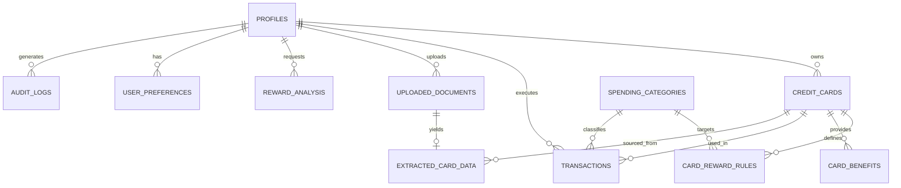

# CLIQ Database Schema Documentation

The database schema is designed for normalized relational storage, enforceability of relational integrity, user ownership boundaries, and high query performance.

## 1. Entity-Relationship Overview

---

## 2. Table Definitions

### 1. `profiles`
User profile and account information.
- `id` (UUID / String, Primary Key): Mirrors auth user ID.
- `email` (String, Unique, Not Null): User email.
- `full_name` (String, Nullable): User full display name.
- `preferred_language` (String, Default 'en'): Preferred language code ('en', 'hi', 'kn').
- `currency` (String, Default 'INR'): Base display currency code.
- `is_active` (Boolean, Default True): Account active flag.
- `created_at` (DateTime, UTC): Record creation timestamp.
- `updated_at` (DateTime, UTC): Record last update timestamp.

### 2. `credit_cards`
User credit card portfolio. Sensitive identifiers like full account numbers and CVVs are strictly excluded.
- `id` (UUID / String, Primary Key)
- `user_id` (UUID / String, Foreign Key -> `profiles.id`, Indexed)
- `card_name` (String, Not Null): e.g. "HDFC Regalia Gold", "Axis Bank Ace".
- `bank_name` (String, Not Null): e.g. "HDFC Bank", "ICICI Bank", "SBI Card".
- `network` (String, Not Null): 'VISA', 'MASTERCARD', 'AMEX', 'RUPAY', 'DINERS'.
- `card_type` (String, Default 'CREDIT'): 'CREDIT', 'CHARGE', 'CO_BRANDED'.
- `last_four_digits` (String, Length 4, Nullable): Display-only masked identifier.
- `annual_fee` (Decimal, Default 0.00): Annual membership fee.
- `renewal_waiver_spend` (Decimal, Nullable): Spend threshold to waive annual fee.
- `billing_cycle_day` (Integer, Nullable): Statement generation day (1-31).
- `is_active` (Boolean, Default True)
- `created_at` (DateTime, UTC)
- `updated_at` (DateTime, UTC)

### 3. `card_reward_rules`
Fine-grained deterministic reward rules associated with a credit card.
- `id` (UUID / String, Primary Key)
- `card_id` (UUID / String, Foreign Key -> `credit_cards.id`, Indexed)
- `category_id` (String, Nullable): Target category (e.g. 'dining', 'travel', 'grocery', 'fuel', 'all').
- `merchant_pattern` (String, Nullable): Specific merchant regex/name (e.g. 'Amazon', 'Swiggy', 'Zomato').
- `reward_type` (String, Not Null): 'CASHBACK', 'REWARD_POINTS', 'MILES'.
- `reward_rate_percentage` (Decimal, Not Null): e.g. 5.00 for 5% cashback or 2.00 for 2%.
- `point_monetary_value` (Decimal, Default 1.00): Rupee value per reward point (e.g. 0.25, 0.50, 1.00).
- `min_transaction_amount` (Decimal, Default 0.00): Minimum spend required to qualify for reward.
- `max_reward_per_transaction` (Decimal, Nullable): Cap per transaction.
- `monthly_cap_amount` (Decimal, Nullable): Maximum monetary reward earnable in a calendar month.
- `is_excluded` (Boolean, Default False): True if this rule defines an exclusion (0% reward).
- `exclusion_reason` (String, Nullable): e.g. "Fuel surcharge exemption", "Wallet load excluded".
- `created_at` (DateTime, UTC)
- `updated_at` (DateTime, UTC)

### 4. `card_benefits`
Perks, complementary lounge access, insurance, and milestones.
- `id` (UUID / String, Primary Key)
- `card_id` (UUID / String, Foreign Key -> `credit_cards.id`, Indexed)
- `benefit_type` (String, Not Null): 'LOUNGE_ACCESS', 'GOLF', 'INSURANCE', 'CONCIERGE', 'MILESTONE'.
- `title` (String, Not Null): e.g. "Complimentary Airport Lounge Visits".
- `description` (Text, Not Null): Terms, limitations (e.g. "4 domestic visits per calendar quarter").
- `annual_value_estimate` (Decimal, Default 0.00): Nominal estimated yearly value.
- `created_at` (DateTime, UTC)

### 5. `spending_categories`
Master standard categories for transaction classification.
- `id` (String, Primary Key): e.g. 'dining', 'grocery', 'travel', 'utility', 'shopping', 'fuel', 'entertainment', 'other'.
- `display_name_en` (String, Not Null)
- `display_name_hi` (String, Not Null)
- `display_name_kn` (String, Not Null)
- `icon_name` (String, Not Null)

### 6. `transactions`
Historical transactions entered or imported by the user.
- `id` (UUID / String, Primary Key)
- `user_id` (UUID / String, Foreign Key -> `profiles.id`, Indexed)
- `card_id` (UUID / String, Foreign Key -> `credit_cards.id`, Nullable, Indexed)
- `category_id` (String, Foreign Key -> `spending_categories.id`, Indexed)
- `merchant_name` (String, Not Null)
- `amount` (Decimal, Not Null)
- `currency` (String, Default 'INR')
- `transaction_date` (DateTime, UTC, Not Null)
- `is_recurring` (Boolean, Default False)
- `reward_earned_monetary` (Decimal, Default 0.00)
- `potential_optimal_reward` (Decimal, Default 0.00)
- `optimal_card_id` (UUID / String, Nullable)
- `notes` (Text, Nullable)
- `created_at` (DateTime, UTC)

### 7. `uploaded_documents`
Metadata for uploaded credit card statements or policy documents.
- `id` (UUID / String, Primary Key)
- `user_id` (UUID / String, Foreign Key -> `profiles.id`, Indexed)
- `filename` (String, Not Null)
- `file_path` (String, Not Null): Path in storage or private upload folder.
- `mime_type` (String, Not Null): 'application/pdf', 'image/png', etc.
- `file_size_bytes` (Integer, Not Null)
- `processing_status` (String, Default 'PENDING'): 'PENDING', 'PROCESSING', 'EXTRACTED', 'VERIFIED', 'FAILED'.
- `error_message` (Text, Nullable)
- `uploaded_at` (DateTime, UTC)

### 8. `extracted_card_data`
Staging table for extracted information awaiting human verification.
- `id` (UUID / String, Primary Key)
- `document_id` (UUID / String, Foreign Key -> `uploaded_documents.id`, Unique)
- `user_id` (UUID / String, Foreign Key -> `profiles.id`, Indexed)
- `extracted_card_name` (String, Nullable)
- `extracted_bank_name` (String, Nullable)
- `extracted_network` (String, Nullable)
- `extracted_annual_fee` (Decimal, Nullable)
- `extracted_rules_json` (Text / JSON, Not Null): Staged array of rules.
- `extracted_benefits_json` (Text / JSON, Nullable): Staged array of benefits.
- `confidence_score` (Decimal, Default 0.85)
- `is_verified` (Boolean, Default False)
- `verified_at` (DateTime, UTC, Nullable)
- `created_at` (DateTime, UTC)

### 9. `reward_analysis`
Audit log of optimization queries executed by users.
- `id` (UUID / String, Primary Key)
- `user_id` (UUID / String, Foreign Key -> `profiles.id`, Indexed)
- `transaction_amount` (Decimal, Not Null)
- `category_id` (String, Not Null)
- `merchant_name` (String, Nullable)
- `recommended_card_id` (UUID / String, Nullable)
- `recommended_card_name` (String, Not Null)
- `expected_monetary_reward` (Decimal, Not Null)
- `effective_reward_rate` (Decimal, Not Null)
- `calculation_breakdown_json` (Text / JSON, Not Null)
- `alternatives_json` (Text / JSON, Not Null)
- `queried_at` (DateTime, UTC)

### 10. `user_preferences`
User financial settings, notification alerts, and optimization priorities.
- `id` (UUID / String, Primary Key)
- `user_id` (UUID / String, Foreign Key -> `profiles.id`, Unique, Indexed)
- `prioritize_cashback` (Boolean, Default True)
- `prioritize_miles` (Boolean, Default False)
- `include_annual_fee_in_net` (Boolean, Default False)
- `monthly_spend_target` (Decimal, Nullable)
- `created_at` (DateTime, UTC)
- `updated_at` (DateTime, UTC)

### 11. `audit_logs`
Security and administrative event trail.
- `id` (UUID / String, Primary Key)
- `user_id` (UUID / String, Nullable, Indexed)
- `action` (String, Not Null): e.g. 'LOGIN', 'CARD_ADDED', 'DOCUMENT_UPLOADED', 'OPTIMIZATION_QUERY'.
- `ip_address` (String, Nullable)
- `user_agent` (String, Nullable)
- `status` (String, Not Null): 'SUCCESS', 'FAILURE', 'WARNING'.
- `details_json` (Text / JSON, Nullable)
- `timestamp` (DateTime, UTC)
