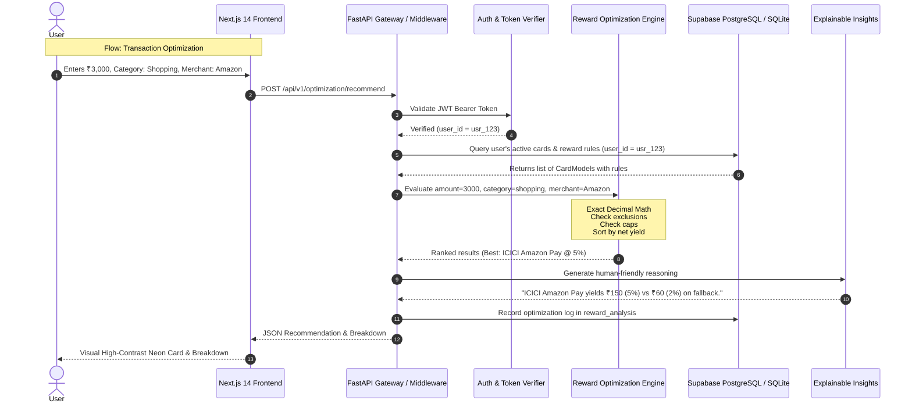

# CLIQ Data Flow Architecture

This document describes the end-to-end data flow across frontend, backend, processing engines, and database.

---

## 1. Document Upload & Extraction Flow
1. User drags and drops a PDF statement in the Document Upload screen.
2. The frontend sends a multipart stream to `POST /api/v1/documents/upload`.
3. The backend checks file signature (`%PDF-`), validates size (<10MB), and saves the file to safe storage under a UUID filename.
4. Document Intelligence triggers text parsing via PyMuPDF.
5. Extraction regex & heuristics parse card issuer, multipliers, caps, and exclusions into a `PendingCardRule` structure.
6. The draft rules are inserted into `extracted_card_data` with status `PENDING`.
7. Frontend displays the extracted rules in an editable verification table.
8. When the user confirms, `POST /api/v1/documents/{id}/verify` commits the verified rules to `credit_cards` and `card_reward_rules`.

---

## 2. Multilingual Assistant Flow
1. User enters a query in English, Hindi, or Kannada.
2. Frontend forwards query and target language code to `POST /api/v1/assistant/chat`.
3. Backend retrieves user's registered cards and benefits.
4. Language Intelligence synthesizes a prompt with strict boundary markers and factual grounding.
5. LLM generates the response in the user's requested language.
6. Citations pointing to user's real cards are attached and returned to the UI.
