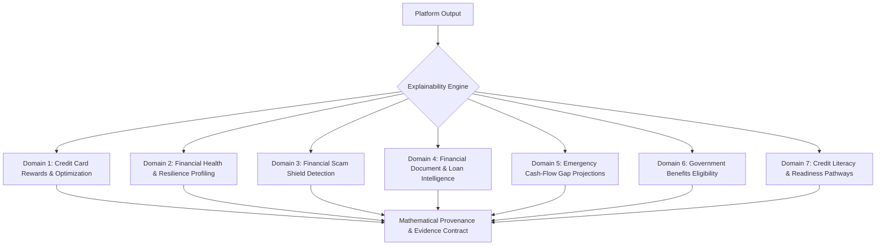

# CLIQ — Universal Explainability (XAI) & Mathematical Provenance Architecture
## Transparent Financial Reasoning for Everyone

> **Release Target:** v0.4.0 Blueprint  
> **Core Objective:** Complete transparency, mathematical auditability, and zero black-box recommendations across all financial domains.  
> **Epistemic Standard:** Explicit differentiation between observed facts, extracted facts, model estimates, and educational guidance.

---

## 1. The Universal Explainability Mandate

In personal finance, unexplained algorithmic outputs create confusion, mistrust, and potentially disastrous financial mistakes. A user presented with a credit card recommendation, a financial health score, a fraud warning, or a loan repayment schedule must be given the exact reason, formula, and evidence behind the output.

CLIQ mandates that **every single output produced by any module in the platform must adhere to the Universal Explainability Contract**:



---

## 2. The Epistemic Differentiation Contract

Every data point presented to the user or consumed by internal explanation generators is tagged with an immutable **Epistemic Classification**:

| Epistemic Tag | Definition | Example in CLIQ | UI Representation |
| :--- | :--- | :--- | :--- |
| **`OBSERVED_FACT`** | Directly recorded, cryptographically verified user action or confirmed transaction. | A verified debit of ₹1,450 at Swiggy on 2026-10-24. | Solid Green Badge: `Verified Transaction` |
| **`EXTRACTED_FACT`** | Parsed directly from an uploaded PDF document with exact page and text coordinates. | Loan Principal ₹2,00,000 on Page 2, Paragraph 3 of sanction letter. | Cyan Badge: `Extracted from Document (P. 2)` |
| **`MODEL_ESTIMATE`** | Computed via deterministic mathematical formula or statistical heuristic. | Effective Reducing APR of 21.8% computed from 12% Flat interest. | Purple Badge: `Calculated Rate` |
| **`HYPOTHETICAL_SCENARIO`** | Simulated what-if scenario based on user-adjustable slider parameters. | "If you cut dining by ₹2,000, your cash-flow shortfall reaches ₹0." | Amber Outline: `Simulated Scenario` |
| **`EDUCATIONAL_INFO`** | General financial literacy guideline from the CLIQ Learn curriculum. | "Keeping credit utilization below 30% helps your CIBIL score." | Blue Badge: `Financial Literacy Concept` |
| **`UNVERIFIED_CLAIM`** | External marketing statement or unverified third-party offer. | "Claimed 10% instant discount on electronics" from external web scrape. | Yellow Warning: `Unverified Claim (Needs Review)` |

---

## 3. Explainability Across All 7 Financial Domains

### 3.1 Domain 1: Credit Card Reward Optimization
- **Answers:** *Why was Card A selected over Card B? What exact formula applied? What caps were encountered?*
- **Trace Output:** Step-by-step arithmetic multipliers, minimum spend checks, monthly cap headroom, and point-to-rupee valuation conversions.
- **Rejection Reason Codes:** `MINIMUM_SPEND_NOT_MET`, `CATEGORY_EXCLUDED`, `MCC_MISMATCH`, `MONTHLY_CAP_EXCEEDED`, `LOWER_NET_YIELD`.

### 3.2 Domain 2: Financial Health & Resilience Profiling
- **Answers:** *How was my resilience score calculated? Why did my score change?*
- **Multi-Pillar Weights:**
  - *Savings Rate (35%):* Compares monthly savings against total inflow.
  - *Credit Utilization (30%):* Aggregate balance vs available credit limits.
  - *Fixed Commitment Drag (20%):* Ratio of recurring bills to total outflow.
  - *Expense Volatility (15%):* Day-to-day spending variance against 90-day moving average.
- **Irregular Income Adaptation:** For freelancers and gig workers, replaces fixed monthly salary with a 90-day rolling median income to avoid score degradation during volatile billing periods.

### 3.3 Domain 3: Financial Scam Shield
- **Answers:** *Why was this message flagged as suspicious? What specific words caused the warning?*
- **Evidence-Backed Breakdown:**
  1. *Detected Risk Indicators:* Lists all triggered rules (e.g., Upfront Fee Demand, Urgency Tactic).
  2. *Verbatim Text Evidence:* Cites exact substrings from the user's message (e.g. `"Pay Rs 999 registration fee to UPI: quick@upi"`).
  3. *Why It Matters:* Explains the scam mechanism (e.g., "Legitimate lenders deduct processing fees from loan disbursals; they never demand upfront UPI transfers").
  4. *Verification Actions:* Directs the user to official sources (RBI Sachet portal, official bank branch).

### 3.4 Domain 4: Financial Document & Loan Intelligence
- **Answers:** *What is the true cost of this loan? Are there hidden fees?*
- **Discrepancy Analysis:**
  - Discloses the mathematical disparity between "Flat Interest Rates" and "Effective Reducing APR".
  - Discloses total repayment over the entire loan tenure: $\text{Total Cost} = \text{Principal} + \text{Interest} + \text{Fees} + \text{GST}$.
  - Page & Coordinate Links: Every extracted loan condition cites the page number and line in the source PDF.

### 3.5 Domain 5: Emergency Intelligence & Cash-Flow Shortfall
- **Answers:** *Why is a shortfall predicted? Which expenses are driving the deficit? How can I fix it?*
- **Shortfall Equation:**
  $$\text{Shortfall} = \max(0, \text{Committed Bills} + \text{Essential Living} - \text{Expected Inflow})$$
- **Actionable Adjustment Levers:** Categorizes expenses into essential (rent, electricity, groceries) vs adjustable (dining, entertainment, subscriptions). Presents non-prescriptive sliders showing how small adjustments close the liquidity gap.

### 3.6 Domain 6: Financial Benefits Navigator
- **Answers:** *Am I eligible for this government scheme? What documents do I need to apply?*
- **Eligibility Criteria Trace:** Compares user profile attributes (age, occupation, income band) against official scheme rules. Clearly distinguishes matched criteria from unmet or unknown requirements.
- **Freshness Attribution:** Displays the official source portal URL and the exact timestamp when the scheme guidelines were last verified.

### 3.7 Domain 7: Credit Literacy & Readiness
- **Answers:** *What steps do I need to take before applying for a credit card or loan?*
- **Readiness Pillars:** Explains the impact of repayment history (35%), credit utilization (30%), credit age (15%), credit mix (10%), and new inquiries (10%).
- **Strict Boundary:** Explicitly clarifies that readiness indicators are educational simulations and do not represent an official CIBIL credit score or loan approval guarantee.

---

## 4. The Universal `CalculationStep` Data Contract

Every domain service implements the standardized `CalculationStep` schema to emit transparent audit traces:

```typescript
export type EpistemicTag = 
  | "OBSERVED_FACT" 
  | "EXTRACTED_FACT" 
  | "MODEL_ESTIMATE" 
  | "HYPOTHETICAL_SCENARIO" 
  | "EDUCATIONAL_INFO" 
  | "UNVERIFIED_CLAIM";

export interface CalculationStep {
  step_number: number;
  step_name: string;
  domain: "rewards" | "health" | "scam_shield" | "loans" | "emergency" | "benefits" | "credit_readiness";
  description: string;
  formula_applied: string;
  inputs: Record<string, number | string | boolean>;
  intermediate_output: number | string | boolean;
  epistemic_classification: EpistemicTag;
  source_citation?: string; // e.g. "Page 2, Line 14" or "Rule ID: HDFC-REG-5X"
  evidence_snippet?: string; // Verbatim text evidence
}

export interface UniversalExplanation {
  primary_verdict: string;
  confidence_score: number; // 0.0 to 1.0
  data_sufficiency: "COMPLETE" | "PARTIAL" | "ESTIMATED";
  steps: CalculationStep[];
  limitations: string[];
  disclaimers: string[];
}
```

---

## 5. Methodological Guardrails: SHAP & Causation

1. **SHAP Usage Boundaries:** SHAP (Shapley Additive Explanations) is reserved strictly for complex, non-linear supervised machine learning models (e.g. future LightGBM transaction classifiers). It is **never** applied to deterministic rules or simple linear heuristics.
2. **Correlation vs. Causation:** Feature importance values must never be presented as proof of causation. Explanations must clarify: *"This factor contributed strongly to the model's estimate, but does not guarantee an outcome."*
3. **No LLM Overrides:** A language model is strictly prohibited from altering, recomputing, or overriding any deterministic calculation trace emitted by Tier 1 engines.
