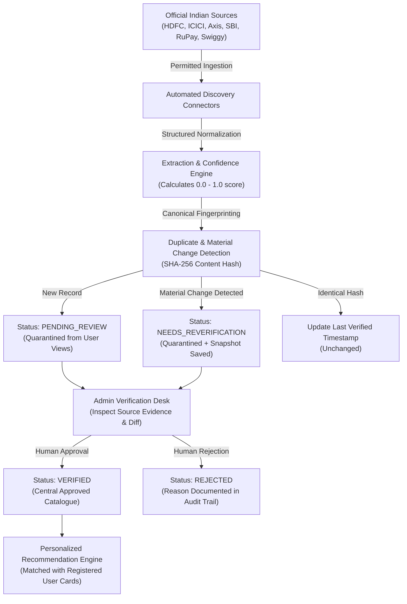
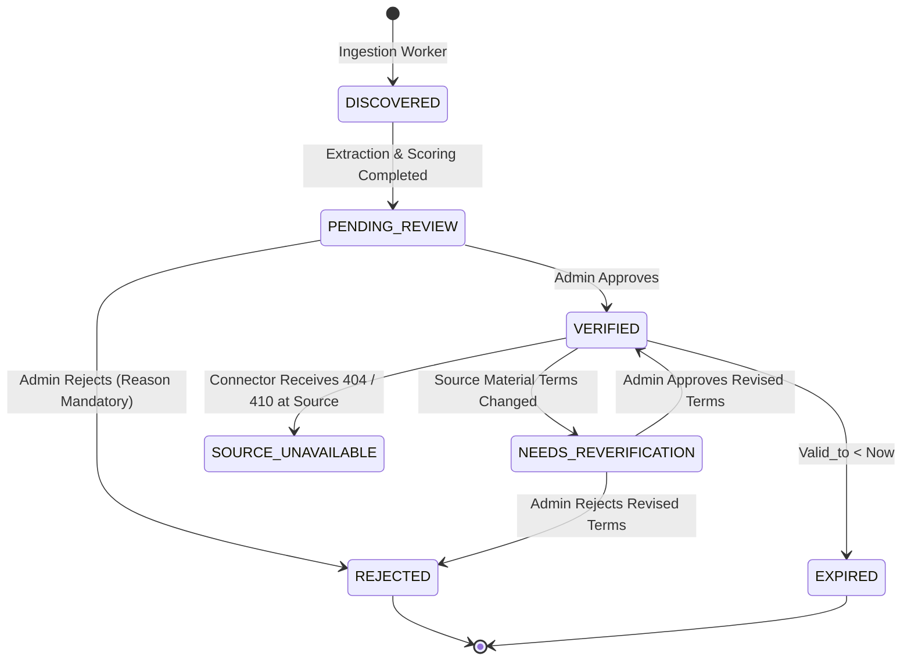

# CLIQ — HYBRID OFFER DISCOVERY ARCHITECTURE
## India-First Credit Card Offer Intelligence & Verification Framework

---

## 1. Architectural Strategy & Operating Model

CLIQ operates under a **Hybrid Offer Discovery Model — India First**. This design supersedes legacy automatic-only ingestion models by enforcing human oversight before any promotional deal can impact user financial calculations.

### The 5-Stage Lifecycle
1. **Automatic Discovery:** Scheduled connectors crawl and poll permitted official bank and merchant portals (respecting `robots.txt`, source terms, and rate limits).
2. **Automated Structured Extraction:** Unstructured deal descriptions, terms, and promotion codes are normalized into standardized database schemas with extraction confidence indicators.
3. **Automated Validation & Canonical Hashing:** Computes deterministic SHA-256 fingerprints across merchant, category, discount value, min spend, caps, promo codes, and card eligibility to prevent duplicate pollution and catch silent source changes.
4. **Mandatory Human Verification:** Authorized administrators review primary source evidence, inspect extracted terms, correct parameters, and approve or reject offers.
5. **Personalized Card Matching:** Only active offers in the `VERIFIED` state can ever be matched against users' registered cards or recommended in purchase decisions.

---

## 2. Permitted Source Connectors (India First)

CLIQ integrates dedicated connectors tailored for Indian retail, banking, and payment networks:

| Connector Name | Target Domain | Supported Deals | Rate Limit & Access Policy |
| :--- | :--- | :--- | :--- |
| **HDFC Bank SmartBuy** | `hdfcbank.com/personal/pay/cards` | 10X reward multipliers, Instant discounts on Swiggy, MakeMyTrip, Flipkart | 1 req/min, static HTML / JSON feed parsing |
| **ICICI Bank Offers Portal** | `icicibank.com/offers` | Amazon Great Indian Festival, Electronics instantaneous 10% cashbacks | Exponential backoff, strictly unauthenticated public pages |
| **Axis Bank GrabDeals** | `axisbank.com/grabdeals` | Dining Delights, Swiggy Dineout 20% off, Croma in-store retail deals | 2 req/min, respects robots.txt |
| **SBI Card Offers** | `sbicard.com/offers` | Domestic flight 12% off, MakeMyTrip partnerships, BookMyShow movie deals | Daily poll cycle |
| **NPCI RuPay Perks** | `rupay.co.in/rupay-offers` | RuPay Select & Platinum BOGO on movies, domestic lounge access, dining | Twice-weekly sync |
| **Swiggy Bank Offers** | `swiggy.com/offers` | Food delivery & Dineout instant coupons (`HDFCFEST`, `AXISDINEOUT`) | Public web checkout promo feeds |
| **Blinkit Quick Commerce** | `blinkit.com/offers` | Grocery weekend instant discounts on HDFC & ICICI cards | Weekend cron trigger |

---

## 3. Strict Offer Status State Machine

CLIQ implements 7 distinct, mutually exclusive offer statuses:

### Status Descriptions
- `DISCOVERED`: Raw payload captured by connector.
- `PENDING_REVIEW`: Structured information extracted; awaiting human admin audit.
- `VERIFIED`: Approved by an administrator. **Only offers in this status can be recommended to end users.**
- `REJECTED`: Rejected by administrator due to ambiguity, expired terms, or partner disagreement.
- `NEEDS_REVERIFICATION`: Previously verified offer whose source terms have changed; quarantined immediately.
- `EXPIRED`: Validity end date has passed.
- `SOURCE_UNAVAILABLE`: Original URL returned HTTP 404 or domain discontinued.

---

## 4. Extraction Confidence vs. Verification Status

Extraction confidence and verification status are strictly decoupled:
- **Extraction Confidence (0.00 – 1.00):** A probabilistic indicator reflecting field completeness, data consistency, and regex boundary conformity.
- **Verification Status (`VERIFIED`, `PENDING_REVIEW`, etc.):** A deterministic governance state set solely by human approval or explicit system status rules. A high extraction confidence score (e.g., `0.98`) **never** bypasses administrator approval.

