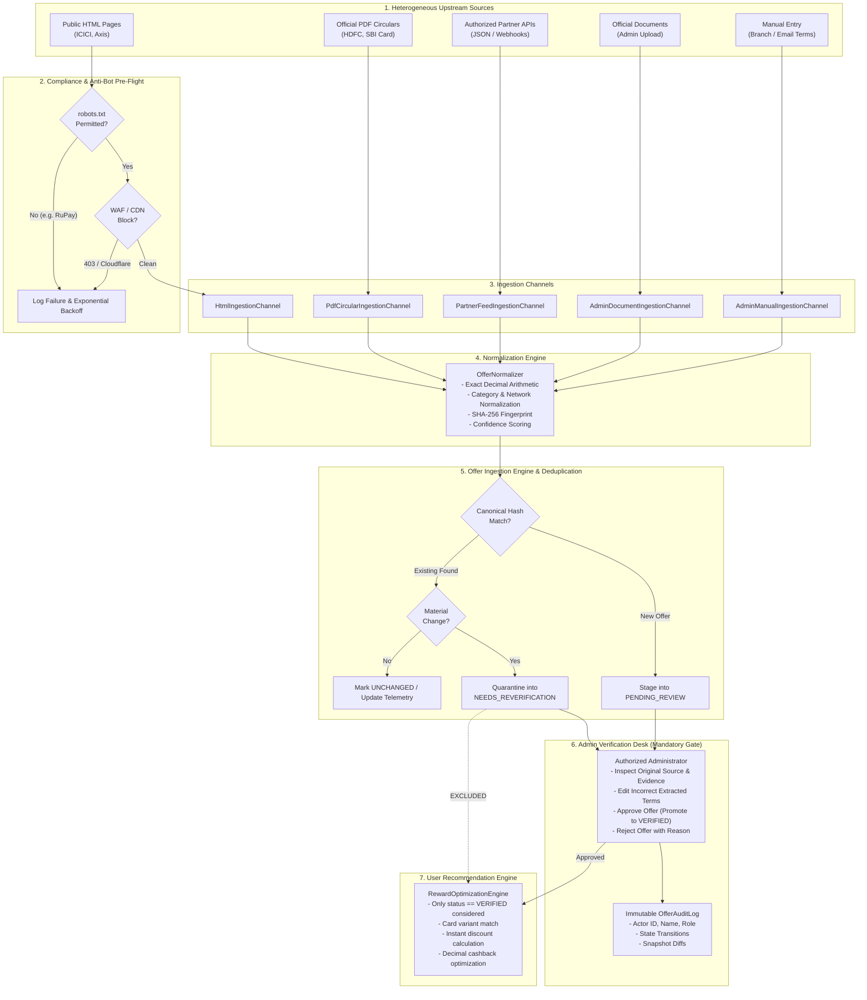

# CLIQ — Offer Intelligence Architecture

## System Overview

CLIQ operates a **hybrid, source-adaptive Offer Intelligence Architecture** designed specifically for the Indian credit card and fintech ecosystem.

It combines multi-source automated collection with strict compliance boundaries, canonical data normalization, and a mandatory **Human-in-the-Loop verification gate**. Only active offers verified by an authorized administrator are permitted to influence user recommendation calculations.

---

## 1. End-to-End Architecture Diagram

---

## 2. Ingestion Flow Lifecycle

### Step 1: Pre-Flight Safety & Source Selection
Before issuing HTTP requests, the channel validates:
- Domain `robots.txt` policy via `urllib.robotparser`.
- Rate limits per minute from `OfferSource`.
- Presence of CAPTCHA, Cloudflare, or Akamai challenges.
- In compliance with guidelines, blocked sources immediately halt and log to `source_failure_logs`.

### Step 2: Extraction & Evidence Capture
- Text from HTML DOM or PDF binary (`CircularParserService`) is searched using structured regex patterns.
- Verbatim evidence snippets (up to 280 characters) are captured and attached.
- Automated extraction confidence score ($0.00$ to $1.00$) is computed based on data completeness.

### Step 3: Canonical Normalization
- All financial numbers are mapped to deterministic `Decimal` objects.
- Categories and networks are mapped to standardized enums.
- A deterministic SHA-256 fingerprint is calculated.

### Step 4: Staging & Change Detection
- **New Offers**: Staged into `PENDING_REVIEW`.
- **Existing Offers (Unchanged)**: Telemetry and freshness timestamps refreshed.
- **Existing Offers (Material Term Shift)**: Immediately quarantined to `NEEDS_REVERIFICATION`. Previous version archived in `previous_version_json`.

### Step 5: Mandatory Human Review Gate
- Authorized admins inspect source evidence, verify terms, edit parameters if needed, and explicitly click **Approve** or **Reject**.
- Only after approval does an offer transition to `VERIFIED`.

### Step 6: Recommendation Calculation
- When a user calculates card rewards via `/api/v1/optimization/recommend` or card utilization in the wallet:
  - Offers with `status != 'VERIFIED'` are **strictly excluded**.
  - Verified instant discounts are calculated using `Decimal` arithmetic.
  - Transparent step-by-step breakdown is presented to the user with verbatim evidence links.

