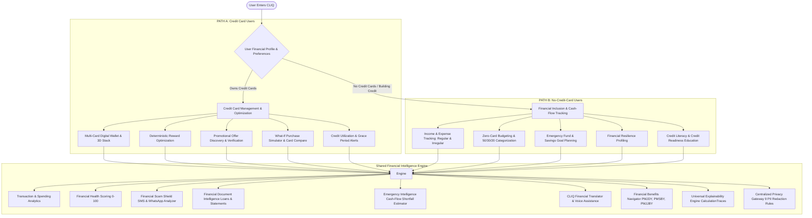

# CLIQ — Comprehensive Product Specification
## Financial Intelligence for Everyone

> **Product Identity:** CLIQ — AI-Powered Personal Financial Intelligence Platform  
> **Vision:** *"Financial intelligence for everyone, not just people who already have access to credit."*  
> **Tagline:** *"Money Made Simple. In Your Language."*  
> **Status:** Production Specification & Architecture Expansion (v0.4.0 Blueprint)  
> **Repository:** `https://github.com/Rahul2006MILLION/AI-Driven-Financial-Insights-and-Credit-Card-Reward-Optimization-Platform`

---

## 1. Executive Summary & Vision Expansion

While CLIQ began with an advanced, deterministic credit card reward optimization and offer discovery engine, credit cards serve only a fraction of India's population. Hundreds of millions of consumers—including students, gig economy freelancers, informal workers, small business owners, and rural citizens—operate entirely outside formal credit channels or have no credit history.

Furthermore, vulnerable consumers are increasingly targeted by predatory digital lending apps, phishing SMS schemes, confusing compound interest structures, and opaque financial products.

**CLIQ v0.4.0 expands from a credit-card companion into a universal, privacy-first personal financial intelligence platform.** CLIQ's mission is to:
1. Provide equal financial intelligence to people **without credit cards** as it does to multi-card optimizers.
2. Democratize financial education and credit readiness in native Indian languages.
3. Protect users against predatory scams and deceptive financial messages via an intelligent Scam Shield.
4. Demystify complex loan documents, bank statements, and government schemes through transparent Explainability.
5. Provide emergency shortfall projections and financial resilience profiling for volatile or irregular incomes.

---

## 2. Two Primary User Pathways

CLIQ establishes two dedicated, first-class user pathways that converge on a shared Financial Intelligence Core:

### Pathway Comparison Matrix

| Dimension | Path A: Credit Card Users | Path B: No-Credit-Card Users |
| :--- | :--- | :--- |
| **Primary Goal** | Maximize rewards, prevent interest fees, track spend caps. | Build savings, stabilize cash flow, build credit readiness. |
| **Card Required?** | Yes ($\ge 1$ card in wallet). | **No (Zero cards required).** |
| **Income Model** | Typically fixed salaried or high-volume business. | Salaried, gig worker, freelancer, student, or irregular income. |
| **Core Tools** | Reward Engine, Card Compare, What-If Simulator, Deals. | Income Tracker, Expense Allocator, Emergency Planner, Resilience Profile. |
| **Shared Intelligence** | Health Score, Document Parser, Scam Shield, Assistant, Learn. | Health Score, Document Parser, Scam Shield, Assistant, Learn. |
| **Education Focus** | Milestone rewards, reward point valuations, lounge quotas. | Debt traps, minimum due awareness, CIBIL basics, credit building. |

---

## 3. User Personas

CLIQ supports six diverse personas spanning India's economic fabric:

| Persona | Financial Context | Primary CLIQ Value Proposition |
| :--- | :--- | :--- |
| **1. The Multi-Card Maximizer** | Owns 3–6 credit cards, spends across travel, dining, and online shopping. | Finds optimal card for every purchase; tracks category spend caps; discovers verified bank promotions. |
| **2. The First-Time Cardholder** | Recently acquired entry-level card; confused by billing cycles and minimum due. | Protects from revolving debt traps; explains grace period; monitors credit utilization below 30%. |
| **3. The Freelancer / Gig Worker** | Variable monthly earnings (₹15,000 to ₹70,000); irregular payment cycles. | Emergency Intelligence models cash-flow shortfalls; resilience profiling tracks variable-income buffer. |
| **4. The Non-Card Budgeter** | Transacts exclusively via UPI, cash, and debit cards; no credit history. | Full income and expense tracking; zero-card budgeting; savings accelerator without card pressure. |
| **5. The Credit Aspirant** | Student or young adult wanting to qualify for their first credit card or education loan. | Credit Readiness module; teaches CIBIL factors, responsible borrowing, and EMI math. |
| **6. The Scam-Vulnerable User** | Frequently receives predatory loan SMS, lottery messages, or WhatsApp investment promises. | Financial Scam Shield analyzes message text, highlights deceptive terms, and warns of upfront fee fraud. |

---

## 4. Shared Financial Intelligence Capabilities

CLIQ's architecture is powered by 10 shared services accessible across both pathways:

### 4.1 Personal Financial Health & Resilience Engine
- Computes multi-pillar financial health scores (0–100) based on savings rate, debt-to-income ratio, fixed commitment drag, and expense volatility.
- Adapts scoring for irregular income earners by using rolling 90-day median income rather than assuming fixed monthly salary.

### 4.2 Financial Scam Shield
- User-initiated analysis of suspicious SMS, WhatsApp forwards, promotional offers, and digital loan ads.
- Detects high-risk indicators: urgency pressure, upfront processing fee demands, impersonation of RBI/banks, unrealistic guaranteed returns, and requests for OTP/PIN/CVV.
- Provides plain-language explanations of detected risks, cited verbatim text, and recommended verification steps.

### 4.3 Financial Document Intelligence
- Ingests bank statements, credit card statements, and loan agreements (PDF and scanned documents).
- Extracts key contractual terms: principal, nominal interest rate, APR, interest calculation type (flat rate vs reducing balance), EMI schedule, processing charges, and penal interest.
- Highlights hidden conditions and provides side-by-side math comparing claimed rates vs true effective rates.

### 4.4 Emergency Intelligence & Cash-Flow Shortfall Projector
- Analyzes upcoming bills, essential expenses, and expected income inflows.
- Projects potential liquidity gaps (e.g. ₹15,000 income vs ₹16,000 committed expenses = ₹1,000 shortfall).
- Models practical, user-driven expense adjustment scenarios without shaming or prescriptive mandates.

### 4.5 CLIQ Financial Translator & Vernacular Voice
- Translates dense banking jargon (e.g., *moratorium, compounding, foreclosure, amortisation, hypothecation*) into clear vernacular explanations in English, Hindi, and Kannada.
- Integrates voice-based expense entry and audio explanation playback with client-side speech processing and strict privacy consent.

### 4.6 Financial Benefits Navigator
- Curated, verified repository of Indian government social security and financial inclusion schemes:
  - *Pradhan Mantri Jan Dhan Yojana (PMJDY)*
  - *Pradhan Mantri Suraksha Bima Yojana (PMSBY)*
  - *Pradhan Mantri Jeevan Jyoti Bima Yojana (PMJJBY)*
  - *Atal Pension Yojana (APY)*
  - *Kisan Credit Card (KCC) & MUDRA Loans*
- Provides verified eligibility criteria, required documents, official application portals, and last-verified timestamps.

### 4.7 Credit Literacy & Credit Readiness Engine
- Interactive curriculum explaining credit bureaus (CIBIL, Experian, Equifax, CRIF High Mark), credit score factors, and credit report errors.
- Prepares non-cardholders for formal credit through transparent readiness indicators without fabricating fake credit scores.

### 4.8 Deterministic Explainability Engine
- Every recommendation, score, calculation, and scam flag generates a structured `CalculationTrace` and audit trail.
- Clearly delineates observed data from estimates, hypothetical scenarios, and educational models.

### 4.9 Centralized Privacy Gateway
- Enforces an automated airlock on all outbound data: 9-rule regex PII scrubbing (Aadhaar, PAN, card numbers, phone numbers, email addresses, UPI IDs, bank accounts, balances, and names).
- Enforces task allowlists and prevents prompt injection attacks.

### 4.10 Comprehensive Multilingual System
- Native localization supporting 8 Indian languages (English, Hindi, Kannada, Tamil, Telugu, Marathi, Bengali, Gujarati) with zero-loss fallback.

---

## 5. Non-Functional & Ethical Guardrails

1. **Non-Advisory Regulatory Boundary:** CLIQ is an informational and analytical tool. CLIQ is **not** a SEBI-registered investment advisor or RBI-regulated lending entity. CLIQ never promises loan approval or credit score increases.
2. **Zero-PII Egress:** No raw personal financial records, card numbers, or government IDs are transmitted to external AI providers.
3. **Zero Financial Shaming:** All insights are educational, constructive, and free of judgmental commentary regarding spending choices or low income.
4. **Deterministic Math:** Financial calculations are never entrusted to generative AI; all numbers are calculated by pure, unit-tested Python code.
5. **Hermetic Multi-Tenancy:** Complete tenant isolation enforced at the database layer through authenticated `user_id` filters, eliminating Insecure Direct Object Reference (IDOR) vulnerabilities.
