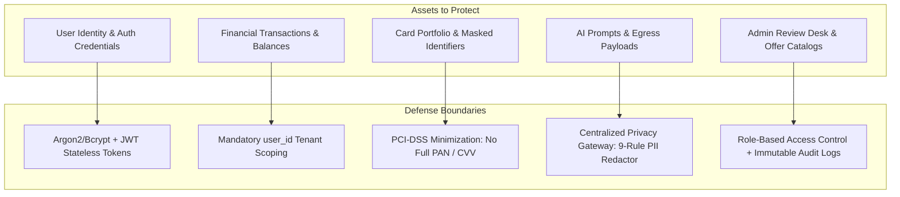
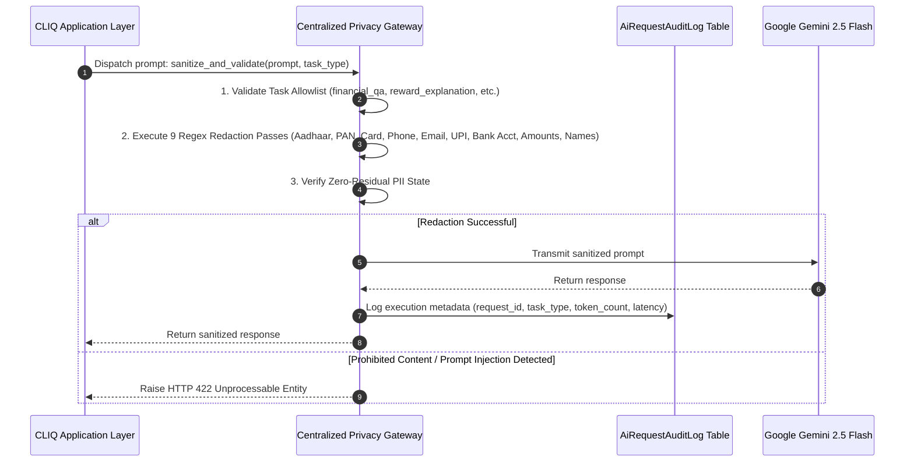
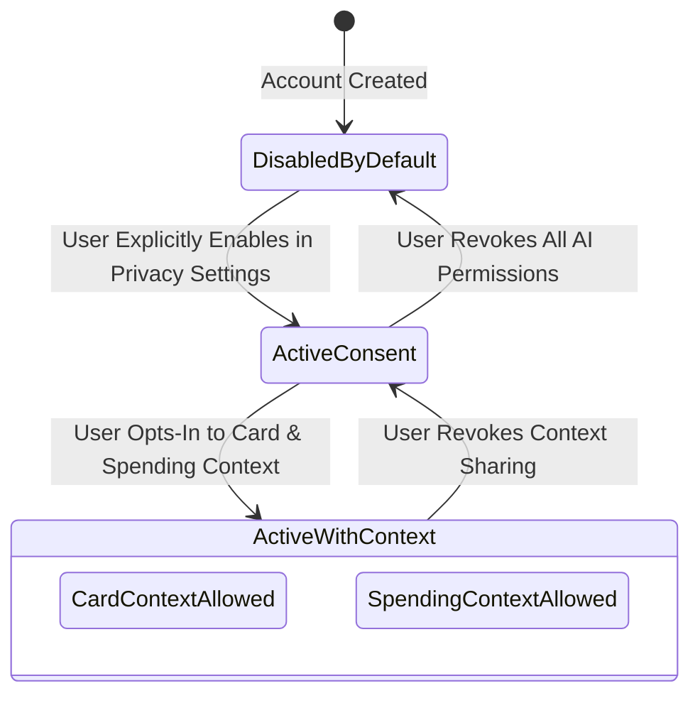

# CLIQ — Comprehensive Security & Privacy Architecture

> **Status:** Production Specification (v0.3.0)  
> **Compliance & Posture:** Privacy-by-Design · Zero-Trust Multi-Tenancy · PCI-DSS Minimization · OWASP Top 10 Aligned  
> **Core Tenet:** Financial data belongs strictly to the user. Zero raw PII egress to third-party AI models.

---

## 1. Threat Model & Assets Inventory

CLIQ's security posture is designed around a comprehensive STRIDE threat model targeting personal financial intelligence platforms:



### STRIDE Assessment & Countermeasures

| Threat Category | Primary Risk in CLIQ | Technical Countermeasure |
| :--- | :--- | :--- |
| **Spoofing** | Attacker impersonates an authenticated user or admin. | Asymmetric JWT Bearer verification; password hashing via bcrypt (work factor 12); strict session revocation on 401. |
| **Tampering** | Modification of transaction amounts, reward rules, or audit trails. | Parameterized SQLAlchemy 2.0 async queries; SHA-256 canonical offer hashing; append-only audit tables. |
| **Repudiation** | User or admin denies performing an action (e.g. approving a fraudulent deal). | Immutable audit logging in `audit_logs`, `offer_audit_logs`, and `ai_request_audit_logs` capturing user ID, IP, and timestamp. |
| **Information Disclosure** | Data leakage through LLM prompts, IDOR parameter tampering, or CORS misconfiguration. | Centralized Privacy Gateway PII scrubbing; database row-level ownership checks (`WHERE user_id = current_user.id`); restricted CORS origins. |
| **Denial of Service** | Scraper hammering, LLM endpoint exhaustion, or CSV upload flooding. | Slowapi rate limiting (60 req/min baseline, strict limits on LLM/Auth); payload size caps (10MB for statements). |
| **Elevation of Privilege** | Standard user accesses administrative verification desk or probes offer sources. | RBAC middleware enforcing `user.is_admin == True` and `user.role == 'ADMIN'`; 403 Forbidden on unauthorized access. |

---

## 2. Centralized Privacy Gateway & PII Sanitization Pipeline

The **Privacy Gateway (`app/services/privacy_gateway.py`)** acts as an airlock between internal user data and any external network API (such as Google Gemini).



### The 9 PII Scrubbing Rules

```python
REDACTION_PATTERNS = {
    "aadhaar": r"\b\d{4}[ -]?\d{4}[ -]?\d{4}\b",
    "pan": r"\b[A-Z]{5}[0-9]{4}[A-Z]{1}\b",
    "credit_card": r"\b(?:\d{4}[ -]?){3}\d{4}\b|\b\d{15,16}\b",
    "phone_in": r"(?:\+91|0)?[6-9]\d{9}\b",
    "email": r"\b[A-Za-z0-9._%+-]+@[A-Za-z0-9.-]+\.[A-Z|a-z]{2,}\b",
    "upi_vpa": r"\b[a-zA-Z0-9.\-_]{2,256}@[a-zA-Z]{2,64}\b",
    "bank_account": r"\b\d{9,18}\b",
    "financial_balance": r"(?:₹|Rs\.?|INR)\s*[\d,]+(?:\.\d{2})?",
    "identity_name": r"\b(?:Mr\.|Ms\.|Mrs\.|Dr\.)\s+[A-Z][a-z]+(?:\s+[A-Z][a-z]+)?\b"
}
```

---

## 3. Four-Tier AI Data Classification Matrix

To enforce strict egress governance, CLIQ classifies all data handled by the platform into four distinct tiers:

| Data Tier | Description | Examples | Transmission Policy to External AI |
| :--- | :--- | :--- | :--- |
| **Tier 1: PUBLIC** | Non-sensitive, publicly available information. | Bank reward structures, standard MCC categories, general financial curriculum. | Permitted freely without redaction. |
| **Tier 2: INTERNAL** | Platform metadata and non-personal operational figures. | Offer source IDs, scraper failure counts, UI theme tokens. | Permitted where operationally required. |
| **Tier 3: SENSITIVE** | Pseudonymous user data and generalized financial aggregates. | Total dining spend last month (₹4,250), category distribution percentages, credit utilization ratio. | **Permitted ONLY with explicit user consent** and through the Privacy Gateway. |
| **Tier 4: HIGHLY SENSITIVE** | Personally Identifiable Information (PII) and raw credentials. | Aadhaar numbers, PAN, full card numbers, CVV, passwords, phone numbers, exact residential addresses. | **STRICTLY PROHIBITED.** Automatically redacted or dropped before network egress. |

---

## 4. User AI Consent & Privacy Transparency Framework

Under CLIQ's privacy principles, access to external AI services is **opt-in by default** and subject to granular user controls stored in the `user_ai_consents` table:



### Consent Flags & Enforcements
- `external_ai_enabled`: Global killswitch. If `False`, all calls to `/api/v1/assistant/chat` immediately return an informative offline template without contacting Gemini.
- `allow_card_context`: Authorizes injecting masked card names (e.g. "HDFC Regalia Gold") into prompt context.
- `allow_spending_context`: Authorizes injecting aggregated category totals (e.g. "Dining: ₹4,000") into prompt context.
- **Revocability:** Users can toggle any flag at any time. When disabled, subsequent calls instantly cut off external data transmission.

---

## 5. Authentication, Session & IDOR Defense

### 5.1 JWT Authentication Lifecycle
1. **Password Hashing:** Passwords are never stored in plaintext; hashed using bcrypt with salt rounds $\ge 12$.
2. **Access Token Issuance:** Upon successful verification at `/api/v1/auth/login`, an RFC 7519 JWT signed with HS256 is returned.
3. **Frontend Token Storage:** Stored in client `localStorage` with bearer token injection in API client request headers.
4. **Automated Session Recovery:** If the API returns a 401 Unauthorized status, the frontend `AuthContext` purges stale tokens and redirects to `/login`.

### 5.2 Insecure Direct Object Reference (IDOR) Defense
CLIQ prevents IDOR vulnerabilities by enforcing **zero trust on client-supplied ownership IDs**:
- The API layer extracts user identity solely from the cryptographically verified JWT payload (`current_user.id`).
- Every database query in services strictly scopes data access:
```python
# CORRECT - Tenant Isolated
stmt = select(CreditCard).where(
    CreditCard.id == card_id,
    CreditCard.user_id == current_user.id
)
```
- Attempting to access an object belonging to another user returns an HTTP 404 Not Found (or 403 Forbidden), preventing account enumeration.

---

## 6. PCI-DSS Minimization & Storage Governance

CLIQ is an analytical companion and reward optimizer, not a payment gateway. As such, CLIQ minimizes compliance footprint by strictly avoiding storage of cardholder payment data:
1. **No Primary Account Numbers (PAN):** CLIQ never stores 16-digit card numbers. Only the user-provided last 4 digits are retained for display identification.
2. **Zero CVV / PIN / Expiry Date Collection:** The frontend forms and backend schemas contain no fields for CVV, security codes, or card PINs.
3. **No Payment Processing:** No payment transactions are executed through CLIQ; users swipe directly at merchants or bank gateways.

---

## 7. Administrative Role-Based Access Control (RBAC)

CLIQ enforces a strict two-tier privilege hierarchy:
- **`USER`:** Access limited to personal cards, personal transactions, simulation calculators, and public offers.
- **`ADMIN`:** Authorized to view scraper failure telemetry, review staged promotional circulars, approve/reject community offers, and trigger source health probes.
- Administrative endpoints (`/api/v1/admin/*`) enforce the `require_admin` FastAPI dependency, returning 403 Forbidden if `user.is_admin` is False.

