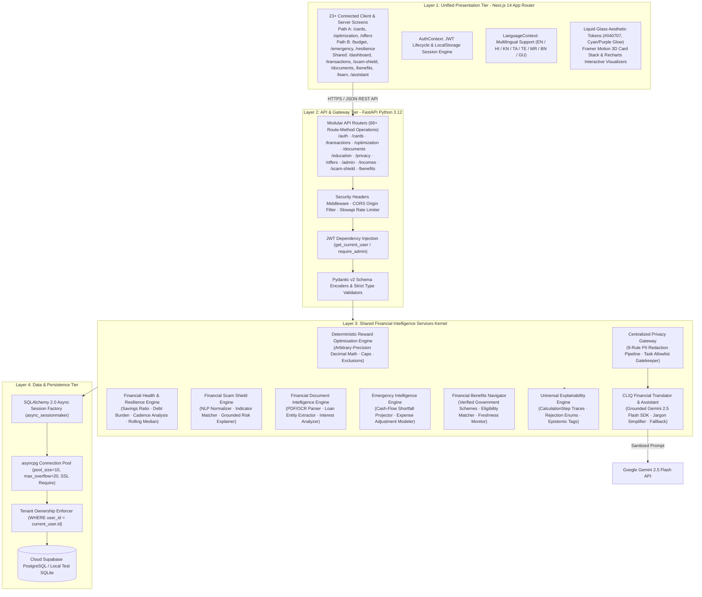
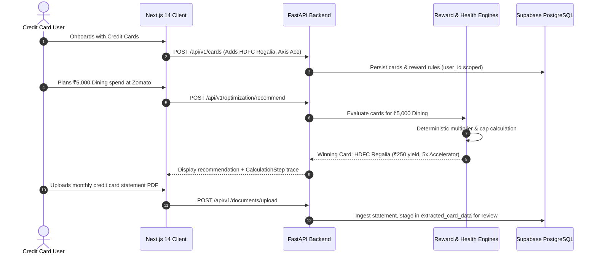
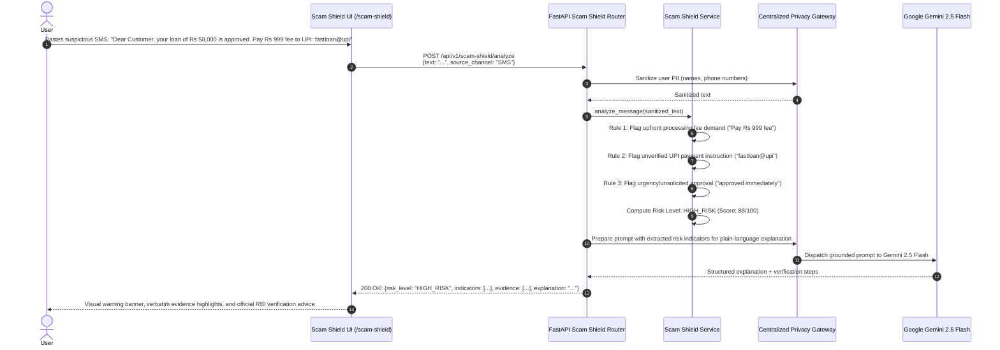
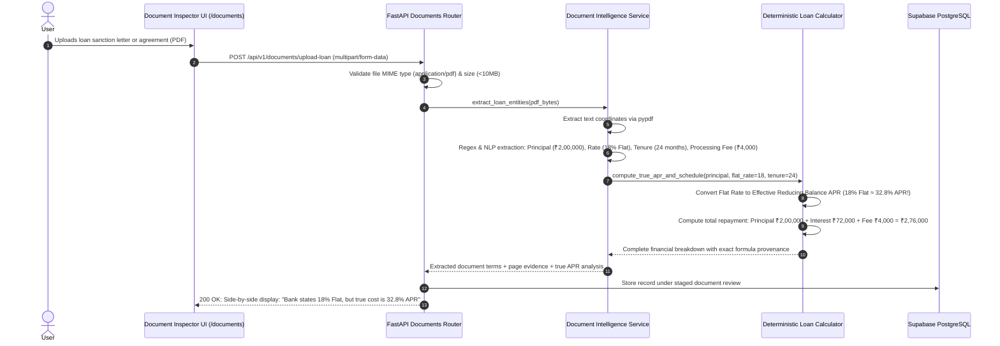
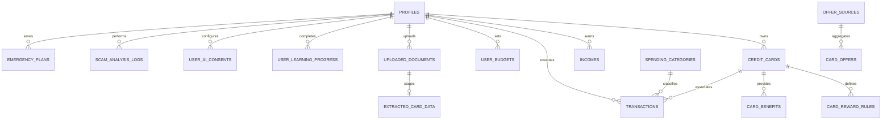

# CLIQ — Comprehensive System Architecture & Multi-Tier Design
## Universal Financial Intelligence Architecture

> **Release Target:** v0.4.0 Blueprint  
> **Applicable Stack:** Next.js 14 App Router (Frontend) · FastAPI Python 3.12 (Backend) · SQLAlchemy 2.0 Async · Supabase PostgreSQL / SQLite  
> **Core Paradigms:** Dual-Pathway User Flow · Shared Intelligence Core · Zero-Trust Multi-Tenancy · Privacy Gateway

---

## 1. High-Level Architectural Blueprint

CLIQ is architected as an asynchronous, decoupled, multi-tier platform serving both credit-card holders and no-credit-card users through a single, shared intelligence kernel.



---

## 2. Two-Pathway User Journeys

### 2.1 Pathway A: Credit Card User Journey



### 2.2 Pathway B: No-Credit-Card User Journey

```mermaid
sequenceDiagram
    autonumber
    actor User as No-Credit-Card User (e.g. Freelancer/Student)
    participant Frontend as Next.js 14 Client
    participant API as FastAPI Backend
    participant Engine as Cash-Flow & Resilience Engines
    participant DB as Supabase PostgreSQL

    User->>Frontend: Onboards: Selects "No Credit Cards / Cash & UPI"
    Frontend->>API: POST /api/v1/profile (Sets pathway = NO_CARD)
    User->>Frontend: Records monthly income (₹25,000 irregular)
    Frontend->>API: POST /api/v1/incomes (amount: 25000, source: "Freelance", frequency: "IRREGULAR")
    API->>DB: Save income record
    User->>Frontend: Imports or enters UPI/cash transactions
    Frontend->>API: POST /api/v1/transactions
    API->>DB: Store transactions (card_id = NULL)
    User->>Frontend: Checks Emergency Intelligence
    Frontend->>API: GET /api/v1/emergency/project-shortfall
    API->>Engine: Compute projected gap: Income ₹25,000 vs Bills ₹27,000
    Engine-->>API: Shortfall = ₹2,000; Suggests 2 non-essential expense adjustments
    API-->>Frontend: Display cash-flow gap & practical adjustment sliders
    User->>Frontend: Explores CLIQ Learn Credit Readiness
    Frontend->>API: GET /api/v1/education/modules/credit-readiness
```

---

## 3. End-to-End Sequence Flows for Advanced Intelligence Services

### 3.1 Financial Scam Shield Analysis Flow



### 3.2 Financial Document Intelligence Loan Extraction Flow



---

## 4. Database Implications & Data Ownership Model

CLIQ enforces strict row-level tenant isolation across all tables. No query may execute without scoping to the authenticated user's ID.



### Schema Extensions: Implemented & Roadmap Capabilities

1. **`incomes` Table (Implemented in Phase 3):**
   - `id` (VARCHAR(36), PK): UUID v4 identifier.
   - `user_id` (VARCHAR(36), FK -> `profiles.id`, Indexed, Cascade Delete): Tenant owner.
   - `source_name` (VARCHAR(128), Not Null): e.g. "Monthly Salary", "Freelance Design", "Rental".
   - `amount` (NUMERIC(12, 2), Not Null): Cycle earnings in INR.
   - `currency` (VARCHAR(3), Default 'INR', Not Null).
   - `frequency` (VARCHAR(32), Default 'MONTHLY', Not Null): 'MONTHLY', 'BI_WEEKLY', 'WEEKLY', 'IRREGULAR', 'ONE_TIME'.
   - `is_irregular` (BOOLEAN, Default False, Not Null): Identifies variable contractor income.
   - `received_date` (DATE, Not Null, Indexed `ix_incomes_received_date`): Exact receipt date for monthly aggregation.
   - `expected_date` (DATE, Nullable): Future expected cash flow.
   - `notes` (VARCHAR(255), Nullable): Optional metadata.
   - `created_at` / `updated_at` (TIMESTAMP).

2. **`scam_analysis_logs` Table (Roadmap Phase 4):**
   - `id` (VARCHAR(36), PK)
   - `user_id` (VARCHAR(36), FK -> `profiles.id`, Indexed, Cascade Delete)
   - `source_channel` (VARCHAR(32), Not Null): 'SMS', 'WHATSAPP', 'ADVERTISEMENT', 'LOAN_OFFER'
   - `risk_level` (VARCHAR(32), Not Null): 'HIGH_RISK', 'SUSPICIOUS', 'NEEDS_VERIFICATION', 'NO_OBVIOUS_INDICATORS'
   - `risk_score` (INTEGER, Not Null): 0–100
   - `detected_indicators_json` (TEXT, Not Null): Serialized indicator array
   - `sanitized_snippet` (VARCHAR(255), Not Null): Non-PII snippet for audit
   - `timestamp` (TIMESTAMP, Default UTC Now, Not Null)

3. **`government_schemes` Table:**
   - `id` (VARCHAR(64), PK): e.g. "pmjdy", "pmsby", "pmjjby", "mudra_shishu"
   - `scheme_name_en` / `scheme_name_hi` / `scheme_name_kn` (VARCHAR(255), Not Null)
   - `category` (VARCHAR(64), Not Null): 'INSURANCE', 'BANKING', 'PENSION', 'BUSINESS_LOAN'
   - `eligibility_criteria_json` (TEXT, Not Null): Age limits, income ceiling, occupation
   - `required_documents_json` (TEXT, Not Null): List of required documents
   - `benefit_description` (TEXT, Not Null)
   - `official_portal_url` (VARCHAR(512), Not Null)
   - `last_verified_at` (TIMESTAMP, Not Null)

4. **`emergency_plans` Table:**
   - `id` (VARCHAR(36), PK)
   - `user_id` (VARCHAR(36), FK -> `profiles.id`, Unique, Cascade Delete)
   - `target_emergency_months` (INTEGER, Default 3, Not Null)
   - `monthly_essential_expense` (NUMERIC(12, 2), Not Null)
   - `current_emergency_savings` (NUMERIC(12, 2), Default 0.00, Not Null)
   - `recommended_reserve_target` (NUMERIC(12, 2), Not Null)
   - `created_at` / `updated_at` (TIMESTAMP)

---

## 5. Reconciled API Endpoint Boundaries

CLIQ's API currently hosts **68 route-method operations** across 11 functional domains. The architectural expansion organizes new capabilities into clean, dedicated routers under `/api/v1/`:

| Router Domain | Current Status | Endpoints Count | Key Operations |
| :--- | :---: | :---: | :--- |
| **Auth & Profile (`/auth`, `/profile`)** | Implemented | 5 | Register, Login, Me, Profile GET/PUT |
| **Credit Cards (`/cards`)** | Implemented | 5 | List, Create, Get, Update, Delete |
| **Transactions (`/transactions`)** | Implemented | 8 | CRUD, CSV Preview, CSV Commit, Feedback |
| **Optimization (`/optimization`)** | Implemented | 3 | Recommend Card, Simulate, Compare |
| **Analytics (`/analytics`)** | Implemented | 3 | Spending, Rewards, Financial Health |
| **Assistant (`/assistant`)** | Implemented | 1 | Chat (Gemini 2.5 Flash + Privacy GW) |
| **Privacy (`/privacy`)** | Implemented | 4 | Consent GET/PUT, Audit Logs, Data Rules |
| **Documents (`/documents`)** | Implemented | 4 | Upload, List, Get, Verify |
| **Offers (`/offers`)** | Implemented | 3 | Public Deals, Create, Get |
| **Admin Offers (`/admin/offers`)** | Implemented | 16 | Review Queue, Approve, Reject, Sources, Probes |
| **Education & Learn (`/education`)** | Implemented | 14 | Modules, Lessons, Quizzes, Calculators (5), Budgets |
| **System (`/health`, `/categories`)** | Implemented | 2 | Health check, Category catalog |
| **Incomes & Cash Flow (`/incomes`)** | *Phase 3 Architecture* | 4 | Incomes CRUD, Irregular Income Forecast |
| **Scam Shield (`/scam-shield`)** | *Phase 4 Architecture* | 3 | Analyze Text, Risk Criteria, Report Sample |
| **Emergency & Resilience (`/emergency`)**| *Phase 6 Architecture* | 3 | Project Shortfall, Resilience Profile, Scenarios |
| **Benefits Navigator (`/benefits`)** | *Phase 8 Architecture* | 3 | List Schemes, Check Eligibility, Scheme Detail |

---

## 6. Security, Privacy & Audio Processing Boundaries

1. **Audio & Voice Processing Boundary (CLIQ Financial Translator):**
   - Speech recognition utilizes client-side Web Speech API wherever supported by the browser, ensuring audio never leaves the user's device.
   - For server-side speech recognition fallbacks, ephemeral in-memory processing is enforced: audio buffers are decoded, transcribed to text, scrubbed through the Privacy Gateway, and immediately purged from RAM without persisting to disk.
   - Voice assistance requires explicit, revocable user permission (`allow_voice_input`).
2. **Scam Shield Text Privacy:**
   - The user must explicitly paste message text into the Scam Shield input field. CLIQ **never** runs background daemons that silently read device SMS or WhatsApp databases.
   - Raw pasted messages are scrubbed of personal phone numbers, receiver names, and personal UPI handles before being logged or explained.
3. **Document Access Isolation:**
   - Uploaded PDF statements and loan sanction letters are stored in private directories or private Supabase storage buckets with restricted read permissions strictly verifying `document.user_id == current_user.id`.
