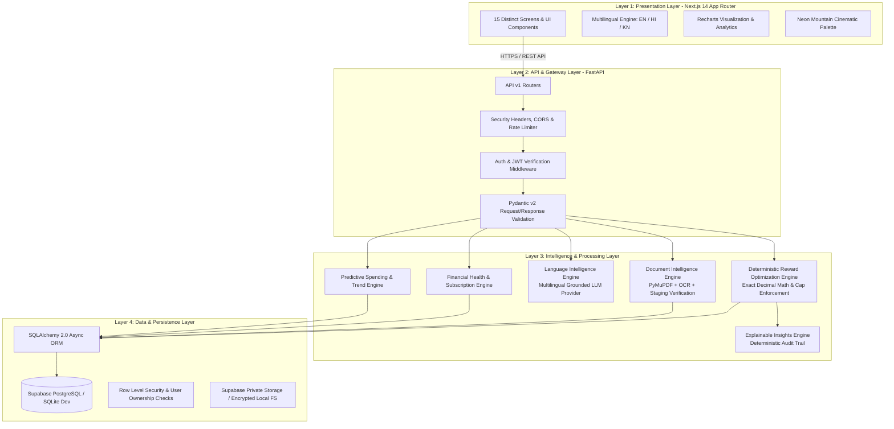

# CLIQ System Architecture

## Architecture Diagram

---

## Architectural Layers & Responsibilities

### Layer 1: Presentation Layer (Next.js 14+)
- **React Server & Client Components** with Next.js App Router.
- **Visual Design:** Dark cinematic aesthetic inspired by *Money Made Simple: Neon Mountain Journey* (#020B12 background, #00E5E5 cyan, #00F5C8 turquoise, #00D69B emerald accents).
- **Client State & Localization:** Client-side i18n support with instant switching between English, Hindi, and Kannada.
- **Visual Analytics:** Interactive Recharts components displaying spend trajectories, category allocations, and reward efficiency.

### Layer 2: API & Gateway Layer (FastAPI)
- **FastAPI Framework** with asynchronous handlers.
- **Zero Trust Security:** Validates JWT Bearer tokens, derives user identity from tokens, never trusts client-provided `user_id`.
- **Validation:** Strict Pydantic v2 data models for input sanitization and serializing responses.
- **Middleware:** Security headers (HSTS, CSP, X-Frame-Options), CORS restricted to authorized frontend origins, per-client in-memory rate limiting.

### Layer 3: Intelligence & Processing Layer
1. **Deterministic Reward Optimization Engine:**
   - Central component executing pure Python deterministic calculations.
   - Arbitrary-precision math (`decimal.Decimal`) prevents floating-point rounding errors.
   - Evaluates eligible cards, base reward rates, category-specific accelerators, merchant partnerships, monthly caps, minimum spend rules, and exclusions.
2. **Document Intelligence Engine:**
   - Ingests PDF statements, terms & conditions, and fee brochures using PyMuPDF.
   - Parses text, detects table patterns, and extracts card name, reward rates, fee structures, and exclusions.
   - Stores extracted data in `extracted_card_data` table under `pending_verification` status. The user must review and approve before rules become active.
3. **Language Intelligence Engine:**
   - Provides conversational assistance in English, Hindi, and Kannada.
   - Connects to configurable LLM provider (Gemini, OpenAI, Anthropic, or Local Heuristic Fallback).
   - Injects authenticated user portfolio and card rules into the context.
   - Strict instructions prevent hallucinating non-existent cards or unverified reward figures.
4. **Financial Health & Prediction Engine:**
   - Scans transaction history for recurring subscription charges.
   - Computes annual fee vs. reward breakeven metrics.
   - Forecasts 30/90 day spend trajectories based on historical velocity.
5. **Explainable Insights Engine:**
   - Translates mathematical calculation steps into human-readable explanations.
   - Details why a card was selected, what multiplier was applied, and whether caps or exclusions were encountered.

### Layer 4: Data & Persistence Layer
- **SQLAlchemy 2.0 Async ORM** providing clean database abstraction.
- **Dual Compatibility:** Supports Supabase PostgreSQL for cloud production and asynchronous SQLite (`sqlite+aiosqlite`) for zero-friction local development and deterministic automated tests.
- **Row-Level Security & IDOR Prevention:** Every query enforces user ownership filters (`WHERE user_id = current_user.id`).
- **Private Storage:** Uploaded card documents are stored in private buckets or isolated local directories accessible only through signed, time-limited tokens.
